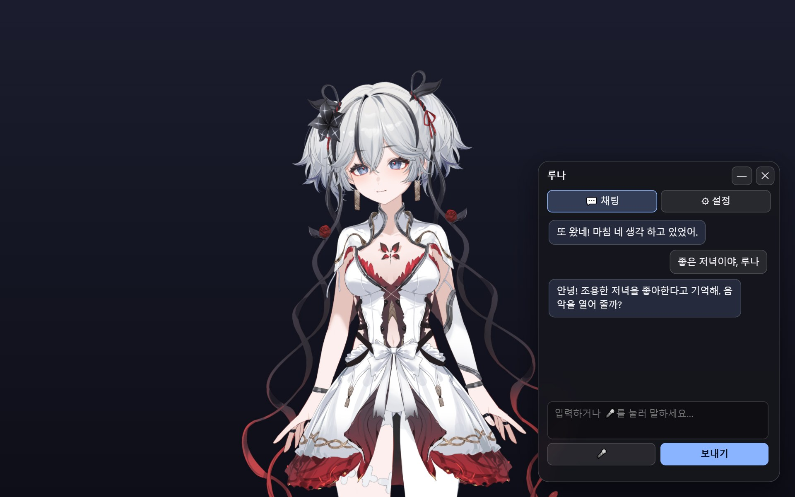
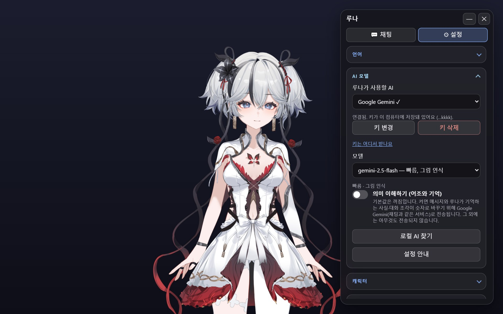

<div align="center">


<br>

# 🌙 루나 (Luna)

### Live2D 아바타와 대화하는 로컬 AI 컴패니언

*목소리로 말하고, 카메라와 화면을 보고, 당신을 기억하고, 코드와 문서 작업을 함께 해요.*

<br>


**Moonlight Team** · 포트폴리오 프로젝트

</div>

---

## ✨ 소개

**루나**는 신경망이 움직이는 Live2D 아바타 캐릭터예요. 말을 걸면 목소리로 대답하고, 허락하면 웹캠과 화면을 보고, 대화 상대를 기억하고, 코드·문서·게임 엔진 작업까지 도와줘요.

서버는 **Python 표준 라이브러리만으로** 만들었고 `127.0.0.1`에서만 열려요. 기억·키·기록은 프로젝트 폴더가 아니라 사용자 폴더(`%APPDATA%\Luna`)에 보관돼요.

<div align="center">

</div>

## 🌌 주요 기능

| | 기능 | 설명 |
|---|---|---|
| 🗣️ | **음성 대화** | 음성 인식과 edge-tts 음성 출력, Windows 기본 음성만 쓰는 오프라인 모드, 손 안 대고 말하는 핸즈프리 모드 |
| 👁️ | **보는 능력** | 허락했을 때만 카메라와 화면을 봐요. 창 제목으로 "지금 뭘 하는지" 알고, 재생 중인 노래도 알아봐요 |
| 🧠 | **기억** | 대화 상대의 이름·취향·가족·순간을 기억하고, 의미가 비슷한 말로도 떠올려요 (로컬 또는 클라우드 임베딩 선택) |
| 💬 | **말투와 감정** | 말투 요청("짧게 말해줘")을 기억하고, 문장의 뜻에 따라 표정과 톤이 달라져요 |
| 📄 | **문서 작성** | Word·PowerPoint·Excel 파일을 대화로 만들어요. 확인 카드를 누르기 전에는 파일이 생기지 않아요 |
| 🛠️ | **개발 도우미** | 코드 읽기·수정, 프로젝트 점검, SQL, git diff, Unreal·Unity·Godot 엔진 작업, 로그 분석 |
| 🔌 | **신경망 선택** | Z.ai, OpenAI, Anthropic, Gemini, OpenRouter 또는 로컬 Ollama·LM Studio·Jan·llama.cpp |
| 🌐 | **4개 언어 UI** | 한국어 · English · Русский · 日本語 |

<div align="center">


</div>

## 🔒 안전과 개인정보

루나는 "모델이 착하게 행동하길 바라는" 방식이 아니라, **구조로 막는** 방식을 택했어요.

- 🛡️ 서버는 `127.0.0.1`에서만 열리고, Host·Origin 검사와 세션 토큰으로 다른 웹페이지의 접근을 막아요.
- 🔑 API 키는 Windows DPAPI로 암호화해 저장하고, 화면에는 마지막 4자리만 보여요. 로그와 오류 메시지에도 들어가지 않아요.
- ✋ 파일 쓰기와 명령 실행은 **확인 카드를 눌러야만** 실행돼요. 쓰기 전에는 백업을 만들고, 모든 동작은 되돌릴 수 있는 기록으로 남아요.
- 🧪 파일·웹·문서에서 읽은 글 속에 숨은 명령은 무력화해요. 개발 명령은 고정된 도구 목록만, Job Object 샌드박스 안에서 실행돼요.
- 🏠 로컬 신경망을 쓰면 대화는 컴퓨터 밖으로 나가지 않아요. (음성 출력 edge-tts만 예외이고, "Windows 음성만" 모드로 끌 수 있어요.)

자세한 위협 모델과 알려진 한계는 [docs/SECURITY.md](docs/SECURITY.md)에 있어요.

## 🚀 빠르게 시작하기

> Windows 10/11 · Python 3.10 이상 (없으면 설치 도우미가 winget으로 설치해 줘요)

```bash
install.bat            # 처음 한 번: 라이브러리, Electron, 아바타용 오프라인 라이브러리
start.bat              # 브라우저(Chrome/Edge)에서 실행
start-desktop.bat      # 데스크톱 창(Electron)으로 실행
```

- 설치 도우미는 **영어·러시아어·한국어·일본어**를 지원하고, Windows 표시 언어를 따라가요. `install.bat --lang ko`로 고를 수도 있어요.
- 설치 도우미는 Ollama를 **설치하지 않아요**. 로컬 AI가 필요하면 직접 설치하세요.
- 신경망은 **설정 → 신경망**에서 고르고, 온라인 서비스는 키를 한 번 입력하면 다음부터 자동으로 연결돼요.

### ⚠️ Live2D 모델에 대해

이 저장소에는 **Live2D 모델이 들어 있지 않아요.** 모델은 각 제작자의 저작물이고, 스크린샷에 나오는 모델도 **시연 목적으로만** 사용했어요. 우리에게는 해당 모델의 저작권이 없어요. 본인이 사용 권한을 가진 모델을 `assets/models/`에 넣어 쓰세요. 자세한 내용은 [NOTICE](NOTICE)를 확인해 주세요.

## 🏗️ 구조

<div align="center">

</div>

| 경로 | 내용 |
|---|---|
| `app.py` | 실행 진입점: HTTP 서버, 대화 엔진, 라우트 |
| `luna/core/` | 성격과 기억, 신경망 연결, 음성, 답변 구성, 기록 |
| `luna/skills/` | 프로그램이 직접 계산하는 기술: 날짜, 계산, 목록, 습관, 알림 등 |
| `luna/senses/` | 청각, 창 제목으로 보는 "화면 속 상황", 노래 인식 |
| `luna/hands/` | 손: 문서, 코드, 프로젝트, 명령, 마우스·키보드, 인터넷 |
| `luna/dev/` | 개발자 도구: 엔진, SQL, git diff, 프로젝트 점검, 로그 |
| `web/`, `index.html` | 웹 화면 (JS/CSS) |
| `desktop/` | Electron 껍데기 |
| `tools/` | 설치 도우미, 정리, 오프라인 라이브러리 다운로드 |
| `tests/` | 테스트 (pytest + 기존 스크립트) |

## 🧪 품질

| | |
|---|---|
| Python 코드 | 약 17,000줄, 74개 모듈 |
| JavaScript | 약 3,600줄 |
| 자동 검사 | pytest 259개 + 기존 점검 2,726개 (합계 2,985개) |
| CI | GitHub Actions (ruff · mypy · pytest) |

```bash
py -m venv .venv && .venv\Scripts\python -m pip install -r requirements-dev.txt
.venv\Scripts\python -m pytest tests/native -n 4     # 전체 테스트
.venv\Scripts\python -m ruff check .                 # 린터
.venv\Scripts\python -m mypy                         # 타입 검사
```

## 📚 문서와 보고서

| 문서 | 링크 |
|---|---|
| 프로젝트 보고서 | [PDF](report/ko/루나%20-%20프로젝트%20보고서.pdf) · [DOCX](report/ko/루나%20-%20프로젝트%20보고서.docx) |
| 코드 설명서 (발표 심사용) | [PDF](report/ko/루나%20-%20코드%20설명서%20%28발표%20심사용%29.pdf) · [DOCX](report/ko/루나%20-%20코드%20설명서%20%28발표%20심사용%29.docx) |
| 발표 자료 | [PPTX](report/ko/루나%20-%20발표%20자료.pptx) |
| English reports | [report/en](report/en) |
| 구조 · 안전 · 개발 | [ARCHITECTURE](docs/ARCHITECTURE.md) · [SECURITY](docs/SECURITY.md) · [DEVELOPMENT](docs/DEVELOPMENT.md) |
| 변경 기록 | [CHANGELOG.md](CHANGELOG.md) |

> 구조·안전·개발 문서와 변경 기록은 현재 러시아어로 작성되어 있어요.

## 📜 라이선스

소스 코드는 [MIT 라이선스](LICENSE)로 공개해요. Live2D 모델 등 제3자 저작물은 이 라이선스에 포함되지 않아요. ([NOTICE](NOTICE) 참고)

---

<div align="center">

🌙 **Moonlight Team** 🌙

*달빛 아래에서 만든 작은 동반자, 루나.*

</div>
