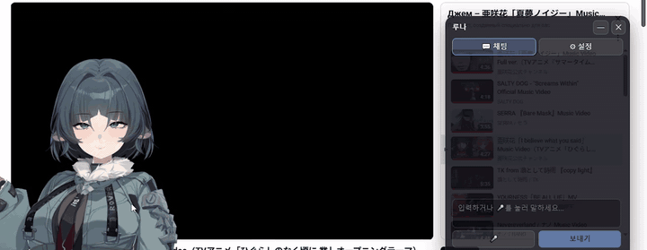
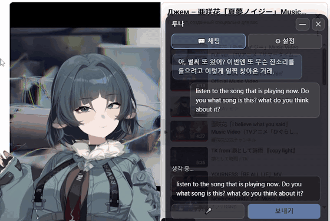
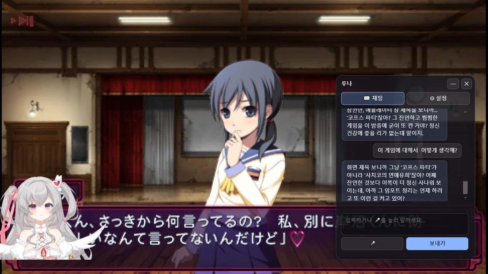
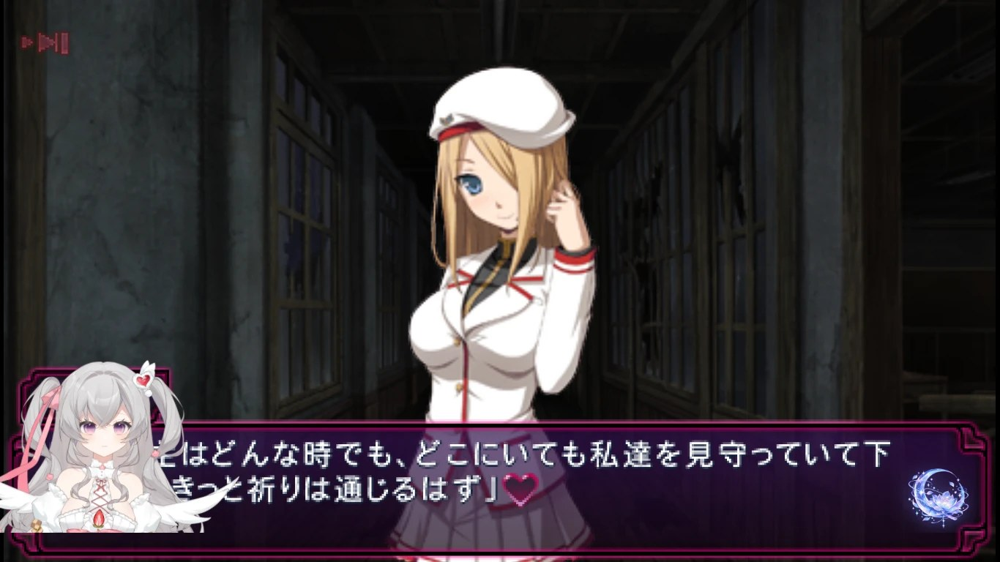
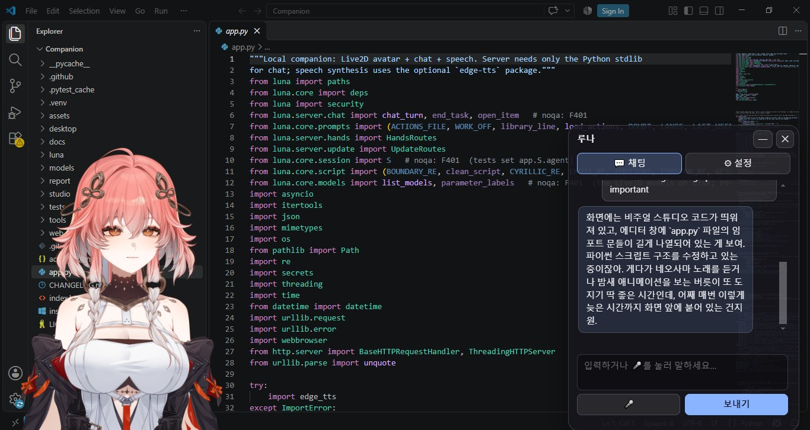
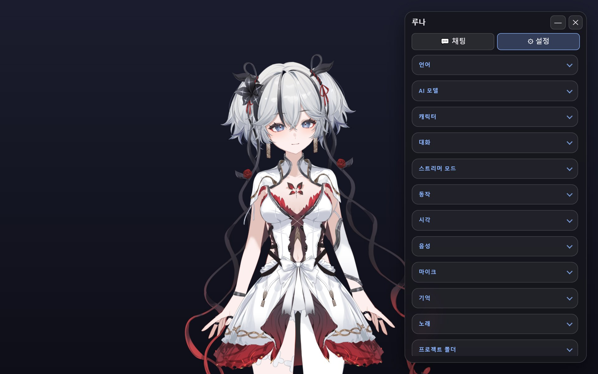
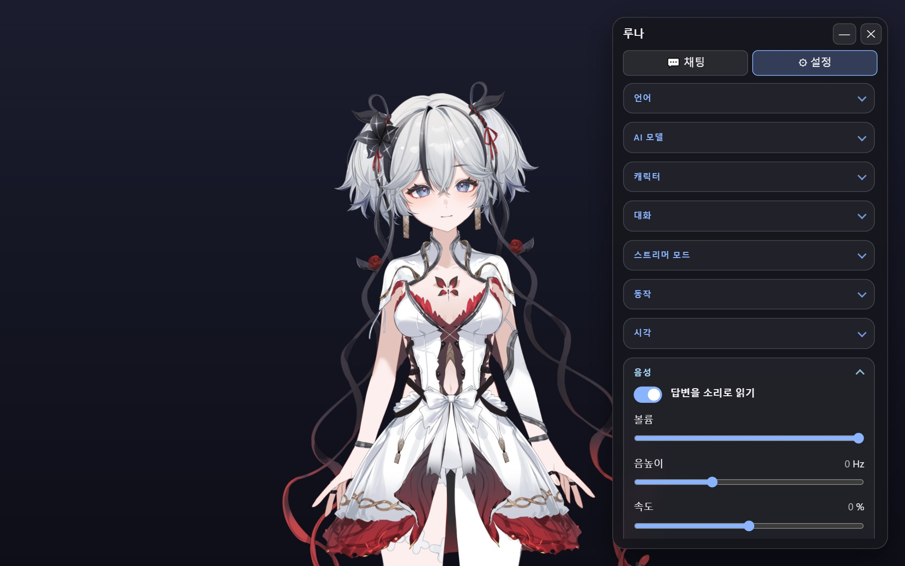
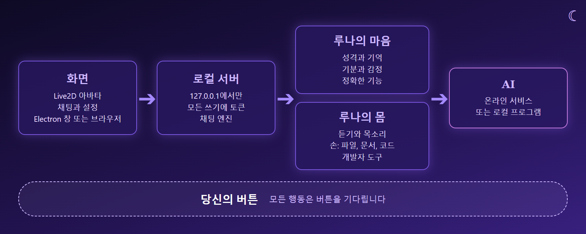

<div align="center">


<br>

# 🌙 루나 (Luna)

### Live2D 아바타와 대화하는 로컬 AI 컴패니언

*목소리로 말하고, 카메라와 화면을 보고, 당신을 기억하고, 코드와 문서 작업을 함께 해요.*

<br>


[**데모**](#-데모) · [**기능**](#-주요-기능) · [**설치**](#-설치와-시작) · [**설정**](#-설정-한눈에-보기) · [**동작 원리**](#-어떻게-동작하나요) · [**안전**](#-안전과-개인정보) · [**문서**](#-문서와-보고서)

**Moonlight Team** · 포트폴리오 프로젝트

<br>



<sub>루나가 화면을 보고 먼저 말을 걸어요. (실제 화면 녹화)</sub>

</div>

---

## ✨ 소개

**루나**는 신경망이 움직이는 Live2D 아바타 캐릭터예요. 말을 걸면 목소리로 대답하고, 허락하면 웹캠과 화면을 보고, 대화 상대를 기억하고, 코드·문서·게임 엔진 작업까지 도와줘요.

- 🧩 서버는 **Python 표준 라이브러리만으로** 만들었고 `127.0.0.1`에서만 열려요. 외부 서버가 필요 없어요.
- 🏠 기억·키·기록은 프로젝트 폴더가 아니라 사용자 폴더(`%APPDATA%\Luna`)에 보관돼요.
- 🔌 신경망은 마음대로 골라요: 온라인 서비스(Z.ai, OpenAI, Anthropic, Gemini, OpenRouter)도, 내 컴퓨터의 로컬 AI(Ollama, LM Studio, Jan, llama.cpp)도 돼요.
- 🛡️ 파일 쓰기나 명령 실행은 **확인 카드를 눌러야만** 실행돼요.

## 🎬 데모

<div align="center">



<sub>**🎵 노래 알아보기** — "지금 나오는 노래가 뭐야?" 하고 물으면 재생 중인 곡을 알아보고, 자기 성격대로 대답해요.</sub>

<br><br>

▶ **[짧은 소개 영상 보기 (MP4, 음성 포함)](docs/media/demo-intro.mp4)**

</div>

> 💡 GIF에는 소리가 없어요. 목소리가 들어간 영상은 위 MP4 링크에서 볼 수 있어요.

## 🖼️ 갤러리

루나는 지금 내가 하는 일을 보고 거기에 맞춰 말해요.

### 🎮 게임할 때

화면의 창 제목을 보고 어떤 게임인지 알아채고, 한마디 던져요.

<div align="center">


</div>

### 💻 작업할 때

코드 편집기를 열어 두면 무슨 파일을 고치고 있는지 알아보고 말을 걸어요.

<div align="center">

</div>

### 🎛️ 설정 화면

<div align="center">




</div>

<sub>※ 스크린샷과 영상 속 아바타 모델과 게임 화면은 시연을 위한 제3자의 저작물이에요. 자세한 내용은 [Live2D 모델 안내](#-live2d-모델-안내)를 확인해 주세요.</sub>

## 🌌 주요 기능

| | 기능 | 설명 |
|---|---|---|
| 🗣️ | **음성 대화** | 음성 인식과 edge-tts 음성 출력, Windows 기본 음성만 쓰는 오프라인 모드, 손 안 대고 말하는 핸즈프리 모드 |
| 👁️ | **보는 능력** | 허락했을 때만 카메라와 화면을 봐요. 창 제목으로 "지금 뭘 하는지" 알고, 재생 중인 노래도 알아봐요 |
| 🧠 | **기억** | 대화 상대의 이름·취향·가족·순간을 기억하고, 의미가 비슷한 말로도 떠올려요 (로컬 또는 클라우드 임베딩 선택) |
| 💬 | **말투와 감정** | 말투 요청("짧게 말해줘")을 기억하고, 문장의 뜻에 따라 표정과 톤이 달라져요 |
| 📄 | **문서 작성** | Word·PowerPoint·Excel 파일을 대화로 만들어요. 확인 카드를 누르기 전에는 파일이 생기지 않아요 |
| 🛠️ | **개발 도우미** | 코드 읽기·수정, 프로젝트 점검, SQL, git diff, Unreal·Unity·Godot 엔진 작업, 로그 분석 |
| 🔌 | **신경망 선택** | 온라인 서비스 또는 로컬 AI 중에서 고르고, 모델도 목록에서 선택 |
| 🌐 | **4개 언어 UI** | 한국어 · English · Русский · 日本語 |

더 자세한 사용법과 말 걸 때 쓸 수 있는 문장 예시는 **[사용법·기능 안내](docs/ko/사용법-기능.md)** 에 있어요.

## 🚀 설치와 시작

> **준비물** — Windows 10/11, Python 3.10 이상 (없으면 설치 도우미가 winget으로 설치해 줘요)

**1. 내려받기**

```bash
git clone https://github.com/Eun-jep/luna-ai-companion.git
cd luna-ai-companion
```

**2. 설치** — 처음 한 번만 해요. 이미 설치된 것은 건드리지 않아서 다시 실행해도 안전해요.

```bash
install.bat
```

**3. 실행**

```bash
start.bat              # 브라우저(Chrome/Edge)에서 실행
start-desktop.bat      # 데스크톱 창(Electron)으로 실행
```

**4. 첫 설정** — 처음 실행하면 3단계 설정 안내(언어 → AI → 팁)가 나와요. **AI 모델**에서 사용할 AI를 고르고(온라인 서비스는 키를 한 번만 입력), 캐릭터 구역에서 Live2D 모델을 고르면 끝이에요.

| 알아 두세요 | |
|---|---|
| 🌍 설치 도우미 언어 | **영어·러시아어·한국어·일본어**. Windows 표시 언어를 따라가고, `install.bat --lang ko`로 고를 수도 있어요 |
| 🔍 확인만 해 보기 | `install.bat --check` — 아무것도 설치하지 않고 상태만 보여 줘요 |
| 🦙 Ollama | 설치 도우미는 Ollama를 **설치하지 않아요**. 로컬 AI가 필요하면 직접 설치하세요 |
| 💾 내 데이터 | 기억·키·기록은 `%APPDATA%\Luna`에 있어요. 폴더를 바꾸려면 환경 변수 `LUNA_DATA_DIR` |

문제가 생기면 → **[설치·시작 안내](docs/ko/설치-및-시작.md)** 의 문제 해결 표를 먼저 확인해 보세요.

## 🎛️ 설정 한눈에 보기

모든 설정은 루나 창의 **⚙ 설정** 탭에 있어요. 바꾼 스위치는 다음 실행에도 **마지막 상태 그대로** 돌아와요.

| 구역 | 할 수 있는 일 |
|---|---|
| 🌐 **언어** | 앱 언어: 한국어 · English · Русский · 日本語 |
| 🔌 **AI 모델** | 온라인 서비스(Z.ai, OpenAI, Anthropic, Gemini, OpenRouter)나 이 컴퓨터의 로컬 AI 고르기, 키 입력·변경·삭제, 모델 선택, 로컬 AI 찾기, 의미 이해하기(어조와 기억) |
| 🎭 **캐릭터** | Live2D 모델 선택, 크기, 배경(밤/낮/녹색 캡처용), 마우스로 옮기기 |
| 💬 **대화** | 루나가 먼저 말 걸기, 생생한 대화 |
| 📡 **스트리머 모드** | Twitch 채팅을 읽고 함께 방송 진행 (손·화면·개인 기억은 쓰지 않아요) |
| 🖐️ **동작** | 사이트·프로그램 열기, 마우스·키보드 사용, 업무 모드(개발·사무 도우미) |
| 👁️ **시각** | 카메라, 화면 보기, 창 제목 알아채기, 컴퓨터 소리 듣기, 노래 알아보기, 시선이 커서를 따라감 |
| 🔊 **음성** | 소리로 읽기, 볼륨·음높이·속도, 음성 엔진(클라우드 / Windows 음성만), 언어별 고유 음성 |
| 🎤 **마이크** | 음성 인식 언어, 버튼 없이 대화, 음성으로 루나의 말 끊기, 마이크 테스트 |
| 🧠 **기억** | 새 대화, 성장 페이지, 기억 지우기 |
| 🎵 **노래** | 내 노래 파일 추가, 루나 목소리 커버 |
| 📁 **프로젝트 폴더** | 루나가 새 파일을 추가해도 되는 폴더 허용 |
| 📜 **기록** | 루나가 한 일 보기와 되돌리기 |
| ⬆️ **업데이트** | 새 버전 확인, 설치, 되돌리기 |

각 항목의 정확한 이름, 기본값, 기억되는 것은 **[설정 안내](docs/ko/설정-안내.md)** 에 정리해 두었어요.

## 🏗️ 어떻게 동작하나요

<div align="center">

</div>

말하거나 입력하면 → 루나가 상황(기억, 화면, 말투)을 모아 신경망에 묻고 → 답을 **연기 대본**(표정·동작·말)으로 바꿔 → 아바타가 움직이고 목소리가 나와요. 날짜 계산이나 목록처럼 정답이 정해진 일은 신경망에 묻지 않고 **프로그램이 직접** 처리해서 빠르고 정확해요.

| 경로 | 내용 |
|---|---|
| `app.py` | 실행 진입점: HTTP 서버, 대화 엔진, 라우트 |
| `luna/core/` | 성격과 기억, 신경망 연결, 음성, 답변 구성, 기록 |
| `luna/skills/` | 프로그램이 직접 계산하는 기술: 날짜, 계산, 목록, 습관, 알림 등 |
| `luna/senses/` | 청각, 창 제목으로 보는 "화면 속 상황", 노래 인식 |
| `luna/hands/` | 손: 문서, 코드, 프로젝트, 명령, 마우스·키보드, 인터넷 |
| `luna/dev/` | 개발자 도구: 엔진, SQL, git diff, 프로젝트 점검, 로그 |
| `web/`, `index.html` | 웹 화면 (JS/CSS) |
| `desktop/` | Electron 껍데기 |
| `tools/` | 설치 도우미, 정리, 오프라인 라이브러리 다운로드 |
| `tests/` | 테스트 (pytest + 기존 스크립트) |

자세한 흐름과 설계 이유는 **[동작 원리](docs/ko/동작-원리.md)** 에서 볼 수 있어요.

## 🔒 안전과 개인정보

루나는 "모델이 착하게 행동하길 바라는" 방식이 아니라, **구조로 막는** 방식을 택했어요.

- 🛡️ 서버는 `127.0.0.1`에서만 열리고, Host·Origin 검사와 세션 토큰으로 다른 웹페이지의 접근을 막아요.
- 🔑 API 키는 Windows DPAPI로 암호화해 저장하고, 화면에는 마지막 4자리만 보여요. 로그와 오류 메시지에도 들어가지 않아요.
- ✋ 파일 쓰기와 명령 실행은 **확인 카드를 눌러야만** 실행돼요. 쓰기 전에는 백업을 만들고, 모든 동작은 되돌릴 수 있는 기록으로 남아요.
- 🧪 파일·웹·문서에서 읽은 글 속에 숨은 명령은 무력화해요. 개발 명령은 고정된 도구 목록만, Job Object 샌드박스 안에서 실행돼요.
- 🏠 로컬 신경망을 쓰면 대화는 컴퓨터 밖으로 나가지 않아요. (음성 출력 edge-tts만 예외이고, "Windows 음성만" 모드로 끌 수 있어요.)

위협 모델과 알려진 한계는 [docs/SECURITY.md](docs/SECURITY.md)에 있어요.

## 🎭 Live2D 모델 안내

이 저장소에는 **Live2D 모델이 들어 있지 않아요.** 모델은 각 제작자의 저작물이고, 스크린샷과 영상에 나오는 모델도 **시연 목적으로만**, 비영리로 사용했어요. 우리에게는 해당 모델의 저작권이 없어요.

모델은 직접 구해서 `assets/models/` 폴더에 넣으면 돼요.

- 🛍️ **[BOOTH에서 무료 Live2D 모델 찾아보기](https://booth.pm/en/search/free%20live2d)** — 무료 모델도, 유료 모델도 있어요.
- ⚠️ 모델마다 이용 약관이 달라요. 사용 범위(개인·방송·상업, 재배포 가능 여부)를 꼭 확인하세요.

## 🧪 품질

| | |
|---|---|
| Python 코드 (테스트 제외) | 약 17,000줄, 앱 모듈 74개 |
| JavaScript | 약 3,600줄 |
| 자동 검사 | pytest 259개 + 기존 점검 2,726개 (합계 2,985개) |
| CI | GitHub Actions (ruff · mypy · pytest) |

```bash
py -m venv .venv && .venv\Scripts\python -m pip install -r requirements-dev.txt
.venv\Scripts\python -m pytest tests/native -n 4     # 전체 테스트
.venv\Scripts\python -m ruff check .                 # 린터
.venv\Scripts\python -m mypy                         # 타입 검사
```

## 📚 문서와 보고서

| 문서 | 링크 |
|---|---|
| 🚀 설치·시작 안내 | [docs/ko/설치-및-시작.md](docs/ko/설치-및-시작.md) |
| 🗣️ 사용법·기능 | [docs/ko/사용법-기능.md](docs/ko/사용법-기능.md) |
| 🎛️ 설정 안내 | [docs/ko/설정-안내.md](docs/ko/설정-안내.md) |
| ⚙️ 동작 원리 | [docs/ko/동작-원리.md](docs/ko/동작-원리.md) |
| 📑 프로젝트 보고서 | [PDF](report/ko/루나%20-%20프로젝트%20보고서.pdf) · [DOCX](report/ko/루나%20-%20프로젝트%20보고서.docx) |
| 🎓 코드 설명서 (발표 심사용) | [PDF](report/ko/루나%20-%20코드%20설명서%20%28발표%20심사용%29.pdf) · [DOCX](report/ko/루나%20-%20코드%20설명서%20%28발표%20심사용%29.docx) |
| 📽️ 발표 자료 | [PPTX](report/ko/루나%20-%20발표%20자료.pptx) |
| 🌍 English reports | [report/en](report/en) |
| 🧱 구조 · 안전 · 개발 | [ARCHITECTURE](docs/ARCHITECTURE.md) · [SECURITY](docs/SECURITY.md) · [DEVELOPMENT](docs/DEVELOPMENT.md) |
| 📝 변경 기록 | [CHANGELOG.md](CHANGELOG.md) |

> 📖 기능을 아주 자세히 적은 [docs/FEATURES.txt](docs/FEATURES.txt)도 있어요. (루나가 알아듣는 러시아어·영어·일본어 명령 예시는 원문 그대로 실려 있어요.) 읽기 쉽게 정리한 안내는 [docs/ko](docs/ko/)에 있어요.

## 📜 라이선스와 고지

소스 코드는 [MIT 라이선스](LICENSE)로 공개해요. Live2D 모델, 게임 화면, 영상 속 콘텐츠 등 제3자 저작물은 이 라이선스에 포함되지 않아요. ([NOTICE](NOTICE) 참고)

---

<div align="center">

🌙 **Moonlight Team** 🌙

*달빛 아래에서 만든 작은 동반자, 루나.*

</div>
