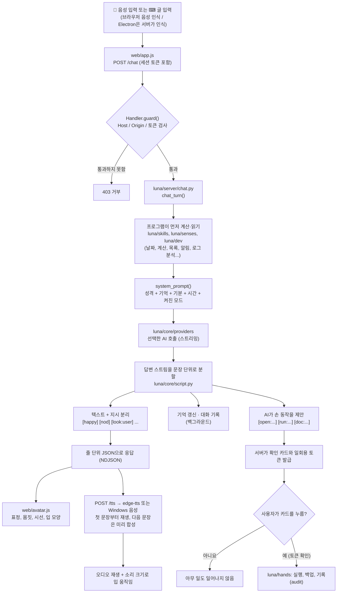

# 🌙 동작 원리

> 루나가 말 한마디를 받아서 대답하고, 표정을 짓고, 목소리를 내기까지의 흐름과 코드 구조, 안전 설계, 테스트 방식을 소개해요.

이 문서는 프로젝트가 궁금한 분, 코드를 살펴보려는 분(채용 담당자 포함)을 위한 글이에요. 사용 방법이 궁금하다면 [사용법과 기능](사용법-기능.md)을 먼저 보세요. 더 자세한 원문 설계 문서는 [ARCHITECTURE](../ARCHITECTURE.md), [SECURITY](../SECURITY.md), [DEVELOPMENT](../DEVELOPMENT.md)에 있어요(현재 러시아어예요).

## 목차

1. [전체 그림](#1-전체-그림)
2. [요청 흐름: 말에서 대답, 아바타 움직임, 목소리까지](#2-요청-흐름-말에서-대답-아바타-움직임-목소리까지)
3. [핵심 설계 아이디어](#3-핵심-설계-아이디어)
4. [패키지 구조](#4-패키지-구조)
5. [보안 모델 요약](#5-보안-모델-요약)
6. [개인 데이터와 기억](#6-개인-데이터와-기억)
7. [테스트 방식](#7-테스트-방식)
8. [알려진 한계](#8-알려진-한계)

---

## 1. 전체 그림

- **서버**: Python 표준 라이브러리(`http.server`)만으로 만든 HTTP 서버예요. `127.0.0.1:47615`(안 되면 빈 포트)에서만 열려요. 진입점은 `app.py`예요.
- **화면**: 브라우저 또는 Electron 껍데기가 `index.html`과 `web/*.js`를 열어요. Pixi와 Live2D로 아바타를 그려요(MediaPipe로 얼굴을 인식해요).
- **두뇌**: 사용자가 고른 신경망(온라인 서비스 또는 로컬 프로그램)이에요. 서버가 `luna/core/providers`를 통해 연결해요.
- **손과 감각**: 컴퓨터에서 무엇을 보고, 듣고, 만지는 일은 모두 서버 쪽 모듈(`luna/senses`, `luna/hands`, `luna/dev`)이 맡고, 사용자가 카드를 눌러야만 실행돼요.

```text
브라우저 / Electron ──HTTP 127.0.0.1:47615──► app.py (Handler)
   index.html + web/*.js                         │
   Pixi + Live2D + MediaPipe                     ├─ chat_turn(): 대화 한 턴 (스트리밍, 줄 단위 JSON)
                                                 ├─ system_prompt(): 기억, 기분, 모드로 프롬프트 조립
                                                 ├─ generate / generate_stream(): luna.core.providers로 신경망 호출
                                                 └─ /act, /tts, /code/read, /doc/read ... (각 동작은 카드의 일회용 토큰으로만)
```

## 2. 요청 흐름: 말에서 대답, 아바타 움직임, 목소리까지

아래 순서도는 한 번의 대화 턴이에요. 카드를 눌러야 하는 "손" 동작은 오른쪽 가지로 분리했어요.



### 단계별 설명

1. **입력**: 글은 입력창에서, 말은 브라우저의 음성 인식(Chrome/Edge) 또는 데스크톱 창에서 서버가 직접 인식해서(`/listen`) 입력창으로 들어와요.
2. **요청 보내기**: 페이지가 `/chat`으로 메시지와 현재 스위치 상태(동작, 업무 모드 등)를 보내요. 서버는 먼저 `Host`·`Origin`·세션 토큰을 검사해요.
3. **프로그램이 먼저 일해요**: `chat_turn()`이 메시지에서 날짜, 계산, 알림, 목록, 습관, 환율, 컴퓨터 상태, 로그, 스택 트레이스 같은 것을 알아보고 **프로그램이 직접 계산하거나 읽어서** 그 결과를 "힌트"로 AI에게 붙여 줘요. AI가 숫자를 어림하지 않게 하려는 거예요.
4. **프롬프트 조립**: `system_prompt()`가 성격, 이 대화에 알맞은 기억(전부가 아니라 가장 알맞은 것들), 기분, 시간대, 현재 켜진 모드, 사용자 스타일 힌트를 모아요.
5. **신경망 호출**: `luna/core/providers`가 선택된 서비스(Z.ai, OpenAI, Anthropic, Gemini, OpenRouter, Ollama, LM Studio, Jan, llama.cpp)로 요청을 보내고 스트리밍으로 받아요. 키는 이 모듈 밖으로 나오지 않아요.
6. **문장 분할과 지시 분리**: `luna/core/script.py`가 흘러오는 답을 문장으로 나누고, `[happy]`, `[nod]`, `[look:user]` 같은 **지시**를 말과 분리해요. 모르는 지시는 버려요. 코드 블록은 음성으로 읽지 않아요.
7. **줄 단위로 전달**: 서버는 JSON 한 줄씩(NDJSON) 흘려보내고, 페이지는 문장을 차례로 재생해요.
8. **아바타**: `web/avatar.js`("연출가")가 지시를 말하는 순간에 맞춰 실행해요. 숨 쉬기, 눈 깜빡임, 시선 이동, 말할 때의 끄덕임, 소리 크기와 모음에 맞춘 입 모양이 함께 움직여요. 답에 감정 지시가 하나도 없으면 문장의 뜻에서 감정을 읽어서(`replyfeel`) 얼굴과 목소리에 반영해요.
9. **목소리**: `/tts`가 문장 하나씩 합성해요(edge-tts 또는 Windows 음성). 속도·높이·크기는 감정 지시, 루나의 기분, 시간대, 문장 부호, 사용자 설정을 합쳐서 안전한 범위 안에서 정해요. 첫 문장이 재생되는 동안 다음 문장이 미리 합성돼요.
10. **뒤처리**: 몇 번의 대화마다 백그라운드에서 기억(사실, 에피소드, 날짜, 기분)을 갱신하고, 중요한 동작은 기록(audit)에 남겨요.
11. **손 동작**: AI가 `[open:…]`, `[run:…]`, 문서·수정 제안 같은 지시를 내면 서버가 **확인 카드**와 일회용 토큰으로 바꿔요. 사용자가 누르면 그 토큰으로 해당 경로(`/act`, `/run/go`, `/doc/make`, `/code/edit` 등)가 실행돼요. 눌러야만 일어나는 일이에요.

## 3. 핵심 설계 아이디어

1. **프로그램이 결정하고, 모델은 제안한다.** AI는 명령 모양의 지시만 쓰고, 서버가 그것을 카드로 바꿔요. 실행은 사용자가 누른 뒤, 그 카드를 위해 발급된 토큰으로만 이뤄져요. 토큰은 일회용이고 유효 시간이 짧아요.
2. **밖에서 읽은 글은 데이터다 ("오염" 처리).** 인터넷, 문서, 코드 파일, 클립보드, SQL 결과, diff 같은 "바깥 글"이 들어온 턴은 *오염된(tainted)* 턴으로 보고, 그 턴에서는 아무것도 저절로 열리거나 실행되지 않아요. 글 속의 명령 모양 표시와 코드 블록은 무력화돼요(`security.neutralize()`).
3. **정확한 계산은 프로그램이.** 날짜, 퍼센트, 단위, 표 요약 같은 건 코드(`luna/skills`)가 계산하고, AI는 말로 옮기기만 해요. 각 기술은 한국어·영어·러시아어·일본어 문장을 알아봐요.
4. **기억은 구조로.** 사실 목록(`memory.json`), 대화 조각(에피소드), 날짜와 약속, 기분 값을 저장하고, 단어·형태·(선택) 의미 기반으로 알맞은 것만 프롬프트에 넣어요.
5. **개인 데이터는 코드와 분리.** 기억·키·기록은 `%APPDATA%\Luna`(`LUNA_DATA_DIR`로 변경 가능)에 있어서 저장소나 압축 파일에 섞일 수 없어요. 테스트는 항상 임시 폴더를 써요.
6. **상태는 객체로.** 대화 한 턴의 가변 상태(켜진 모드, 언어, 카메라 등)는 전역 변수 대신 `Session` 객체에 담아요.

## 4. 패키지 구조

| 경로 | 내용 |
|---|---|
| `app.py` | 진입점. HTTP 서버(`Handler`)와 주요 경로(`/chat`, `/tts`, `/act`, `/listen`, `/hear`, `/stream/*`, `/state`…), 시작 절차 |
| `luna/paths.py` | `DATA_DIR`(개인 데이터 위치), `ROOT`, 예전 파일 이전(`migrate`) |
| `luna/security.py` | Host/Origin 검사, 토큰, CSP·보안 헤더, `neutralize()`. 의존성 없는 순수 함수 |
| `luna/core/` | 루나의 "속": 성격과 기억(`character`, `memory_store`, `episodes`), 신경망 연결(`providers`), 어조·감정(`feeling`, `replyfeel`, `lexicon`), 프롬프트와 답변 구성(`prompts`, `script`, `convo`), 음성(`voice`), 모델 목록(`models`, `catalog`), 기록(`audit`), 업데이트(`updater`) 등. HTTP는 몰라요 |
| `luna/skills/` | 프로그램이 직접 계산하는 기술: 날짜(`dates`), 정확한 계산(`exact`, `mathtalk`), 환율(`money`), 목록(`lists`), 습관(`habits`), 알림(`reminders`), 오늘 할 일(`agenda`), 운(`chance`), 말투(`manners`), 컴퓨터 상태(`pcstate`), 스탠드업(`standup`), 표 요약(`tables`), 방송(`stream`), 엔진 레시피(`recipes`), "뭘 할 수 있어?"(`abilities`) |
| `luna/senses/` | 감각: 소리 듣기(`hearing`), Windows 음성(`localtts`), 창 제목으로 보는 "화면 속 상황"(`media`), 노래 인식(`songid`). 처리는 로컬에서 해요 |
| `luna/hands/` | 손: 문서 읽기(`docfiles`), Word/PowerPoint/Excel 생성(`office`), 코드 수정(`codeedit`), 프로젝트 생성(`projects`), 명령 실행(`runner`, `sandbox`), 마우스·키보드(`control`, `inputctl`, `agent`), 인터넷(`netsearch`), 루나의 공간(`nook`), 노래 라이브러리(`studio`). 세상을 바꾸는 일은 전부 카드와 클릭이 필요해요 |
| `luna/dev/` | 개발자 도구: 엔진 연동(`unreal_bridge`, `godot_bridge`, `unity_bridge`, `engines`), SQL(`sqlrun`, `sqlcheck`), git diff(`gitdiff`), 프로젝트 점검(`codescan`), 로그·스택 분석(`logs`, `traces`), 환경 진단(`envdiag`), 테스트 목록(`testgen`), 설정 파일 점검(`infra`), 엔진 에러 패턴(`gameerrors`). 카드를 누르기 전에는 읽기만 해요 |
| `luna/server/` | `app.py`에서 분리된 서버 부분: 대화 엔진(`chat.py`의 `chat_turn`), 손 경로(`hands.py`), 업데이트 경로(`update.py`), 늦은 참조(`appref.py`) |
| `web/`, `index.html` | 웹 화면: 채팅·설정(`app.js`), 아바타 연출(`avatar.js`), 카메라(`vision.js`), AI 설정(`provider.js`), 설정 안내(`wizard.js`), 4개 언어 문구(`i18n.js`) 등 |
| `desktop/` | Electron 껍데기: 투명한 창, 클릭 통과, 트레이, 화면 캡처, 단축키 |
| `tools/` | 설치 도우미(`install.py`), 정리(`cleanup.py`), 오프라인 라이브러리 내려받기(`fetch_vendor.py`), 감정 임계값 측정 등 |
| `tests/` | 테스트 (pytest + 기존 스크립트) |

`chat_turn`은 `_turn_text`(무엇을 답할지), `_turn_hints`(프로그램이 계산·읽은 것), `_Got`(AI가 답에서 요청한 것들), `_deliver`(말이 끝난 뒤의 처리)로 나뉘어 있어요. 분리된 코드는 `from app import X` 대신 `_app().X`로 접근해서 테스트가 함수를 바꿔 끼울 수 있어요.

### AI가 아바타를 조종하는 방법

AI의 답은 평범한 글이 아니라 **지시가 섞인 대본**이에요. 예를 들면 이래요.

```text
[happy] 안녕! [nod] 반가워. [look:up] 어디 보자… [look:user] [tilt] 너는 어때?
```

- 감정: `[neutral] [happy] [sad] [angry] [surprised] [shy] [love] [confused] [excited]`
- 몸짓: `[nod] [shake] [tilt] [wink] [lean] [shrug] [bow] [giggle] [sigh] [bounce]` (모델에 해당 파라미터가 있으면 `[puff]`, `[blush]`도)
- 시선: `[look:user|left|right|up|down|away]`

서버는 모르는 지시를 버리고, 채팅과 음성에는 깨끗한 글만 보내요. 모델이 직접 만들지 않은 동작(숨 쉬기, 눈 깜빡임, 시선 흔들림, 생각할 때 위를 보기, 들을 때 고개 기울이기 등)은 `avatar.js`가 자동으로 해요.

## 5. 보안 모델 요약

위협은 네 가지로 봤어요: ① 사용자의 브라우저에서 열린 **다른 웹페이지**(DNS rebinding, CSRF), ② 루나가 읽는 **바깥 글**에 숨은 명령, ③ 개인 데이터와 키의 **유출**, ④ 사용자 **파일의 손상**.

| 위협 | 방어 |
|---|---|
| 다른 웹페이지의 접근 | 서버는 `127.0.0.1`에서만 열려요. `Host`가 `127.0.0.1`/`localhost`/`[::1]`이 아니거나 `Origin`이 자기 것이 아니면 403으로 거부해요 |
| 토큰 추측 | 세션 토큰(`secrets.token_urlsafe(32)`)을 상수 시간 비교로 확인하고, 페이지는 `/`와 `/growth`에서만 토큰을 받아요 |
| XSS, 프레임 삽입 | CSP에 `unsafe-inline`과 `unsafe-eval`이 없고(인라인 스크립트는 응답마다 새 nonce), `frame-ancestors 'none'`, `X-Frame-Options`, `Referrer-Policy`, `nosniff`를 써요. WebAssembly 때문에 `'wasm-unsafe-eval'`만 남아 있어요 |
| 바깥 글 속의 명령 | `neutralize()`로 무력화하고, 그런 글을 읽은 턴은 오염 처리해서 아무것도 저절로 실행되지 않으며, 실행은 카드 클릭으로만 |
| 키 유출 | API 키는 Windows DPAPI로 암호화해 `keys.dat`에 저장해요. 화면에는 마지막 4자리만 보이고, 로그와 오류 메시지에도 들어가지 않아요. 프로젝트 폴더 밖에 있고 `.gitignore`에도 들어 있어요 |
| 개인 데이터 | `%APPDATA%\Luna`에 저장해요. 테스트는 항상 임시 폴더에서 돌아요 |
| 개발자 명령 | 카드와 클릭이 있어야 하고, 고정된 도구 목록만, **셸 없이** 실행해요. Windows Job Object 안에서 돌고(프로세스 트리 종료, 프로세스 수와 메모리 제한, 클립보드·시스템 설정 접근 차단, 출력 읽기 제한), 환경 변수에서 키·토큰·비밀번호를 빼고, 디스크 루트·홈·시스템 폴더에서는 실행하지 않아요 |
| 파일 손상 | 쓰기는 카드 클릭 뒤에만, 백업 후에만 하고, 모든 동작은 되돌릴 수 있는 **기록**(audit)으로 남겨요 |
| 서드파티 라이브러리 | `tools/fetch_vendor.py`가 `web/vendor/`로 내려받아 SHA-256을 확인하고, 페이지는 로컬 복사본을 써요(인터넷 없이도 돼요) |
| 의미 임베딩 | 로컬 임베딩은 loopback 주소의 Ollama만 허용해요. 클라우드 임베딩은 사용자가 직접 켠 경우에만 해요 |

**알려진 한계**(솔직하게): 업데이트는 서명되지 않아요(체크섬 무결성만). 명령 샌드박스는 자원·프로세스 제한이지 **파일·네트워크 격리가 아니에요**. 음성 합성(edge-tts)은 말할 문장을 Microsoft로 보내요(끄려면 "Windows 음성만"). Electron 껍데기의 일부 동작은 자동 테스트로 확인하지 못했어요. 자세한 내용은 [SECURITY.md](../SECURITY.md)를 보세요.

## 6. 개인 데이터와 기억

```text
사용자의 말 ──► 프롬프트에 알맞은 기억만 선택 ──► 답변
        │                                         │
        └──── 몇 번마다 백그라운드 ◄────────────────┘
              사실 갱신 · 에피소드 · 날짜/약속 · 기분 · 일기
```

- `memory.json`에 사실 목록(사용자와 루나 자신), 일기, 기분(기쁨·에너지), 최근 대화, 에피소드가 들어 있어요. 백업도 만들어요.
- 기분은 루나 자신의 감정 표현에 따라 움직이고 시간이 지나면 평소로 돌아와요. 기분은 프롬프트와 아바타의 표정·움직임에 반영돼요.
- 프롬프트에는 전부가 아니라 현재 대화에 알맞은 사실이 들어가요(단어 겹침, 형태, 최근성, 자주 돌아오는 주제, 선택적으로 의미 유사도).
- 에피소드와 사실은 **정보**로만 프롬프트에 넣고 지시로 취급하지 않아요. 에피소드 요약은 저장 전에 `neutralize`를 거쳐요.
- 어조 읽기와 의미 기반 기억은 임베딩이 있을 때만 의미로 동작하고, 없으면 단어 목록과 형태 일치로 동작해요.

## 7. 테스트 방식

| 구분 | 내용 |
|---|---|
| **pytest (새 테스트)** | `tests/native/`: 보안 검사(Host/Origin), 프롬프트 주입 방어, 업데이트, 샌드박스, 기억 저장과 검색, 어조·감정, 대화 스트림, Windows 음성, 의존성 점검, 경로 등. 페이지를 실제 Edge에서 여는 종단 간 테스트(`test_e2e_page.py`, Playwright)도 있고 환경이 없으면 건너뛰어요 |
| **기존 스크립트** | `tests/test_*.py`: `PASS`/`FAIL`을 출력하는 스크립트 파일들이에요. `tests/native/test_legacy_scripts.py`가 파일마다 하위 프로세스로 돌려서 판정해요. `tests/legacy_counts.json`에 파일별 `PASS` 개수를 적어 두고, 개수가 줄어들면(검사가 조용히 사라지면) 실패해요 |
| **격리** | 테스트는 실제 데이터를 건드리지 않아요. `luna/paths.py`가 테스트 중에는 임시 폴더를 골라요. 가짜 신경망과 가짜 네트워크를 써서 토큰도 쓰지 않아요 |
| **정적 검사** | `ruff`(린터, 일부 보안 규칙 포함)와 `mypy`(핵심 모듈 타입 검사) |
| **CI** | GitHub Actions(Windows)에서 `ruff check`, `mypy`, `pytest tests/native -n 4`를 돌려요 |
| **자동화하지 못한 것** | Electron 창의 모양, 트레이, 실제 Unreal Engine, 실제 AI와 키, 실제 마이크·스피커. 이런 부분은 눈과 귀로 확인해야 해요 |

```bash
py -m venv .venv && .venv\Scripts\python -m pip install -r requirements-dev.txt
.venv\Scripts\python -m pytest tests/native -n 4          # 전체
.venv\Scripts\python -m pytest tests/native -m "not slow"  # 빠른 테스트만
.venv\Scripts\python -m ruff check .                       # 린터
.venv\Scripts\python -m mypy                               # 타입 검사
```

새 기술을 추가하는 순서(요약): `luna/skills/`에 모듈을 만들고(문장 인식은 `luna/core/lexicon.py`) → `chat_turn`에 연결하고(바깥 글이면 `neutralize`와 오염 처리) → `tests/native/`에 pytest를 추가하고 → 기능 설명서와 변경 기록에 적어요. 자세한 내용은 [DEVELOPMENT.md](../DEVELOPMENT.md)를 보세요.

## 8. 알려진 한계

- Live2D 모델은 이 저장소에 없어요([설치 및 시작](설치-및-시작.md#6-live2d-모델-넣기) 참고).
- 목소리의 감정은 글자와 높낮이 조정으로 만든 표현이라, 감정 스타일이 있는 합성 음성과는 달라요.
- 인식 단어 목록(한국어·일본어)은 사람이 고른 것이라 표현에 따라 놓칠 수 있어요.
- 이 프로젝트는 AI의 도움을 받아 작성했어요. 코드를 읽을 때 이 점을 염두에 두세요.

---

[설치 및 시작](설치-및-시작.md) · [사용법과 기능](사용법-기능.md) · [설정 안내](설정-안내.md)

[← 처음으로 돌아가기 (README)](../../README.md)
