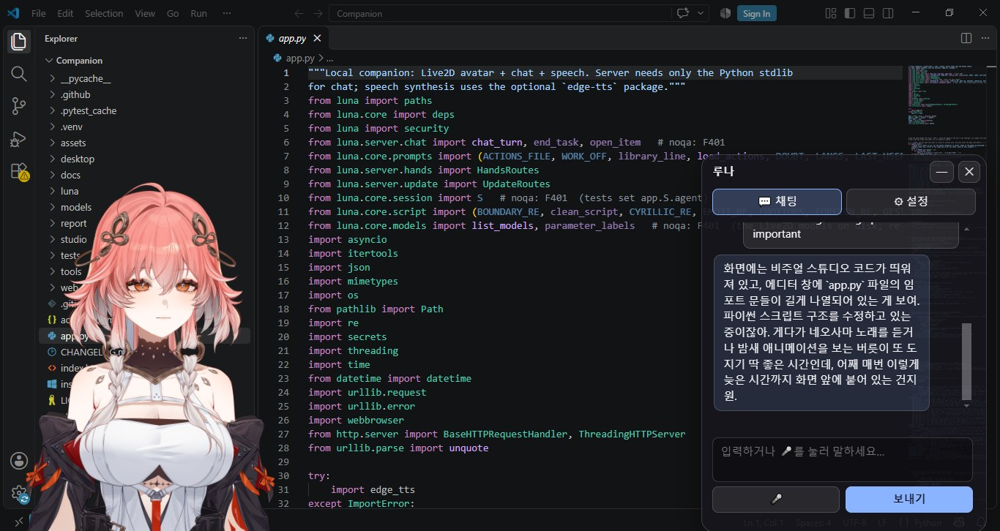

# 🌙 사용법과 기능

> 루나에게 무엇을 부탁할 수 있는지, 어떻게 말하면 되는지, 그리고 컴퓨터를 만지는 일을 어떻게 안전하게 다루는지 정리했어요.

## 목차

1. [기본 사용법](#1-기본-사용법)
2. [대화와 음성](#2-대화와-음성)
3. [보고 듣는 능력: 카메라, 화면, 노래](#3-보고-듣는-능력-카메라-화면-노래)
4. [기억과 사람들](#4-기억과-사람들)
5. [말투와 감정](#5-말투와-감정)
6. [프로그램이 직접 계산하는 기술](#6-프로그램이-직접-계산하는-기술)
7. [문서 만들기: Word, PowerPoint, Excel](#7-문서-만들기-word-powerpoint-excel)
8. [개발 도우미](#8-개발-도우미)
9. [손: 사이트 열기, 마우스와 키보드, 명령 실행](#9-손-사이트-열기-마우스와-키보드-명령-실행)
10. [확인 카드: 안전 규칙을 쉬운 말로](#10-확인-카드-안전-규칙을-쉬운-말로)
11. [솔직한 한계](#11-솔직한-한계)

> 예시 문장은 코드와 기능 설명서에 실제로 적힌 한국어 표현이에요. 비슷한 말도 대부분 알아듣지만, 단어가 너무 다르면 놓칠 수 있어요. 프로그램이 직접 계산하는 기술은 한국어·영어·러시아어·일본어를 지원해요.

---

## 1. 기본 사용법

- **입력**: 아래 입력창에 쓰고 `보내기`를 누르세요. 🎤를 누르면 말로 입력할 수 있어요.
- **탭**: `💬 채팅`과 `⚙ 설정` 두 개예요. 설정은 [설정 안내](설정-안내.md)를 보세요.
- **말 끊기**: 루나를 클릭하거나 `Esc`를 누르면 말하는 도중에도 멈춰요. 말한 부분까지는 대화 기록에 남아요.
- **`—` 버튼**은 패널 최소화, `✕`는 패널 닫기예요. 닫으면 💬 버튼으로 다시 열 수 있어요.
- **새 대화**: 설정 → 기억 → `새 대화 (기억은 유지)`를 누르면 화면의 대화만 새로 시작해요. 기억은 그대로 남아요.
- 루나는 **스트리밍**으로 답해요. 한 문장씩 써 내려가고, 첫 문장이 끝나면 바로 목소리가 나오기 시작해요.
- 답 속의 `[happy]`, `[nod]` 같은 표시는 아바타에게 주는 지시여서 화면에 글자로 나오지 않고, 표정과 동작으로 바뀌어요. ([동작 원리](동작-원리.md) 참고)

## 2. 대화와 음성

| 하고 싶은 일 | 방법 |
|---|---|
| 글로 이야기하기 | 입력창에 쓰고 보내기 |
| 말로 이야기하기 | 🎤 버튼. 브라우저(Chrome/Edge)는 내장 음성 인식, 데스크톱 창은 이 컴퓨터에서 직접 인식해요 |
| 버튼 없이 계속 말하기 | 설정 → 마이크 → `버튼 없이 대화` |
| 루나가 말하는 중에 목소리로 끊기 | 설정 → 마이크 → `음성으로 루나의 말을 끊기` (헤드폰 권장) |
| 루나가 먼저 말 걸게 하기 | 설정 → 대화 → `루나가 먼저 말 걸기` |
| 방 안에 있는 사람처럼 더 자주 말 걸게 하기 | 설정 → 대화 → `생생한 대화` |
| 목소리 끄기, 볼륨·높이·속도 조절 | 설정 → 음성 |
| 인터넷 없이 목소리 내기 | 설정 → 음성 → `음성 엔진` → `Windows 음성만 (오프라인)` |

**알아두면 좋은 것**

- 루나는 시작할 때 **먼저 인사**해요. 기억과 시간대, 마지막으로 이야기한 지 얼마나 됐는지를 반영해요.
- 조용한 시간이 길면 가끔 먼저 말을 걸어요. 사용자가 입력하거나 말하는 중에는 끼어들지 않고, 대답이 없을 때 연달아 두 번 넘게 말하지 않아요.
- `생생한 대화`를 켜면 훨씬 자주(몇십 초 간격으로) 말하고, 생각, 질문, 혼잣말, 몸짓만 하기 등 방식이 다양해져요. 질문에 답이 없어도 재촉하지 않고, 침묵이 이어지면 간격이 점점 넓어져요.
- **노래**: 설정 → 노래에서 mp3, wav, ogg, flac, m4a 파일을 추가하세요(파일당 80MB, 최대 60곡, 이 컴퓨터에만 저장돼요). 그런 다음 "**(곡 제목) 불러줘**"처럼 부탁하면 그 **녹음 자체**를 재생하면서 입을 맞추고 박자에 맞춰 춤을 춰요. 들리는 목소리는 원래 가수의 것이고 루나의 목소리가 아니에요. 목록에 없는 곡을 부탁하면 "나는 직접 노래하지 않고 녹음을 재생한다"고 솔직하게 말해요. 노래는 `중지` 버튼, 루나 클릭, `Esc`로 멈춰요.
- 목소리는 문장 부호, 감정 표시, 시간대(깊은 밤엔 조용하고 느리게), 루나의 기분에 따라 속도·높이·크기가 달라져요. 다만 웃음은 "녹음된 웃음"이 아니라 글자와 조정된 목소리예요.

## 3. 보고 듣는 능력: 카메라, 화면, 노래

보고 듣는 기능은 **전부 사용자가 켠 뒤에만** 작동해요. 켜기 전에 무엇이 어디로 가는지 확인 창이 떠요. 설정 화면의 스위치는 재시작해도 **마지막 상태 그대로** 유지돼요. (한 번 확인을 받은 스위치는 다시 묻지 않아요.)

| 기능 | 켜는 곳 | 하는 일 | 프라이버시 |
|---|---|---|---|
| **카메라** | 설정 → 시각 → `카메라` | 얼굴 위치를 보고 시선을 맞춰요. 웃으면 따라 웃고, 자리를 비우면 알아채요. | 얼굴 인식은 이 컴퓨터에서 해요. 영상은 저장도 전송도 하지 않고, 루나(AI)는 사진이 아니라 "옆에 있어요 / 웃고 있어요 / 가버렸어요" 같은 글만 알아요. 화면 구석에 작은 창과 표시등이 떠요. |
| **화면 보기** (데스크톱만) | `화면 보기` | 가끔 화면을 보고 본 것에 대해 이야기해요. 직접 "지금 뭐 하고 있어?", "이거 어때?"라고 물어도 돼요. | 이미지는 선택한 AI로 전송되고 저장되지 않아요. 바로 끄기: `Ctrl+Alt+L`. 그림을 볼 수 있는 모델이 필요해요. |
| **보거나 듣는 것 알아채기** (데스크톱만) | `보거나 듣는 것 알아채기` | 활성 창의 **제목만** 읽어요. 영화, 애니, 영상, 노래 이름을 알면 감상을 이야기해요. | 화면도 소리도 가져오지 않아요. 플레이어나 스트리밍 사이트처럼 보이는 제목만 AI로 가요. `루나가 먼저 말 걸기`가 켜져 있어야 해요. |
| **컴퓨터에서 나는 소리 듣기** (데스크톱만) | `컴퓨터에서 나는 소리 듣기` | 스피커로 나오는 소리를 짧게 듣고 음악인지 말소리인지 이해해요. | **마이크는 절대 쓰지 않아요.** 소리는 이 컴퓨터에서 글 메모로 바뀐 뒤 버려져요. 통화·메신저 중에는 아예 듣지 않아요. |
| **소리로 노래 알아보기** (데스크톱만) | `소리로 노래 알아보기` | "이 노래 뭐야?"라고 물었는데 창 제목에 답이 없으면, 약 10초 소리의 디지털 지문을 만들어 Shazam 서비스에 보내 제목을 알아내요. | 소리 자체는 보내지 않고 지문만 보내요. 기본은 꺼짐이에요. 비공식 클라이언트라 어느 날 안 될 수도 있어요. |
| **시선이 커서를 따라감** | `시선이 커서를 따라감` | 켜면 시선이 마우스 커서를 따라가요. 끄면 AI가 시선과 머리를 조종해요. | - |

**예시**

- "지금 화면 보여? 뭐 하고 있는지 봐 줘."
- "이 노래 뭐야?" (노래 알아보기를 켰을 때)
- "나 지금 뭐 보고 있게?" (`보거나 듣는 것 알아채기`를 켰을 때)

루나는 작품을 **선택한 AI가 아는 만큼만** 알아요. 모르면 솔직하게 말하고 되물어요. 줄거리나 사실을 지어내지 않도록 되어 있어요.

## 4. 기억과 사람들

루나의 기억은 `%APPDATA%\Luna\memory.json`에 있어요. 사용자의 이름, 취향, 가족, 중요한 순간을 기억하고, 루나 스스로 알게 된 것도 따로 적어 둬요.

- **사실 기억**: 대화 몇 번마다 AI가 최근 이야기를 훑어서 사실 목록을 갱신해요. 중복은 합치고 오래된 것은 정리해요. 프롬프트에는 전부가 아니라 지금 이야기에 **가장 알맞은 것들**만 들어가요.
- **의미로 떠올리기**: 같은 단어가 아니어도 뜻이 비슷하면 떠올릴 수 있어요. 설정 → AI 모델의 `의미 이해하기 (어조와 기억)` 스위치(Gemini/OpenAI)나 로컬 임베딩을 쓸 때만 돼요. 꺼져 있으면 단어와 형태가 겹치는 것으로 찾아요.
- **대화 조각(에피소드)**: "지난주에 영화 결말로 토론했다"처럼 *무슨 이야기를 했는지*를 재시작 후에도 기억해요. (사실은 *누구인지*, 에피소드는 *무엇에 대해*예요.)
- **날짜와 약속**: 시험, 마감, 생일 같은 날짜와 서로의 약속을 대화에서 뽑아 두고, 시작 인사에서 한 가지만 살짝 챙겨요. "내일 시험이지?", "어제 늦게까지 안 잤네, 괜찮아?" 같은 식이에요. 같은 날짜를 너무 자주 말하지 않고, 습관을 잔소리하지 않아요. **캘린더나 메일은 연결되어 있지 않아요**. 날짜는 대화에서만 알아요.
- **함께한 날**: 7일, 30일, 100일, 200일, 365일(이후 매년)에 한 번 따뜻하게 말해요.
- **성장 페이지**: 설정 → 기억 → `루나의 성장 페이지`. 나이, 만남 횟수, 메시지 수, 기분(기쁨·에너지), 일기, 관심을 가졌던 것, 기억하는 사실, `우리의 대화`, 변해 온 과정이 보여요. 항목마다 `잊게 하기` 버튼으로 **하나씩 지울 수 있어요**.
- **모두 지우기**: 설정 → 기억 → `루나의 기억 지우기`. 되돌릴 수 없어요. `memory.json`을 직접 열어 고칠 수도 있어요.
- **일기와 반성**: 루나는 시작할 때와 긴 대화 중에 지난 대화를 돌아보며 일기를 쓰고, 다음에 묻고 싶은 질문을 마련해요.
- **스스로 읽기**: 시작할 때(6시간에 한 번 이하) 자기 취향에 맞는 주제를 골라 위키백과(인터넷 필요)를 읽고 느낌을 적기도 해요.
- **루나의 공간**: 루나가 자기 일기·생각·스케치를 쓰는 폴더(`문서\Luna\Nook`)예요. 설정 → `루나의 공간` → `기록 보기`로 읽을 수 있어요(읽기 전용). 거기에는 새 글을 쓰거나 덧붙일 수만 있고, 덮어쓰거나 지울 수 없어요. 비밀번호나 키처럼 보이는 내용은 적지 않아요.

**예시**

- "내 이름은 ○○이야." / "나 고양이 키워."
- "내가 어제 뭐라고 했지?"
- 설정에서 "기억 지우기"를 누르면 모두 잊어요.

사용자 스타일도 기억해요. 짧게 쓰는지 길게 쓰는지, 이모티콘을 쓰는지, 어느 언어를 쓰는지, 몇 시쯤 말을 거는지에 대해 **평균 숫자만** 보관하고, 사용자의 말 자체는 저장하지 않아요.

## 5. 말투와 감정

### 말투 요청

말투를 부탁하면 기억해 둬요. "**앞으로**"처럼 계속 적용하라는 말이 들어 있으면 재시작 후에도 유지되고, 그런 말이 없으면 **그 대답 한 번만** 적용돼요.

| 예시 | 의미 |
|---|---|
| "짧게 말해줘" / "더 자세히 말해줘" | 길이 조절 |
| "농담하지 마" / "농담 좀 더 해줘" | 유머 조절 |
| "더 쉽게 설명해줘" | 쉬운 설명 |
| "영어로 대답해줘" | 언어 지정 |
| "앞으로 나를 ○○라고 불러줘" | 호칭 (이름은 언제나 기억해요) |
| "원래대로" | 요청 모두 해제 |

말투를 바꿀 뿐 **성격은 그대로**예요. 인터넷에서 읽은 글이 말투를 바꾸지는 못해요.

### 감정 읽기와 표현

- 루나는 사용자의 말투(무례함, 화, 슬픔, 피곤함, 기쁨, 고마움, 사과, 몸이 안 좋음)를 글자에서 읽어요. 슬프면 고치려 하기보다 곁에 있어 주고, 피곤하다면 더 부드럽고 짧게 말하고, 무례하게 굴면 서운해하고, 사과하면 풀려요. 서운함은 몇 시간 안에 가라앉아요.
- 단어 목록으로 먼저 보고, 뜻으로도 읽을 수 있어요. 뜻으로 읽는 것은 `의미 이해하기`를 켰을 때만 돼요.
- 대화가 슬픔이나 화로 끝났으면(말이 아니라 *분위기와 시간*만 기억해요) 다음에 만났을 때 한 번만 조심스럽게 안부를 물을 수 있어요. 몸이 안 좋다고 하면 위로하고 다음에 한 번 물어봐요. **진단은 하지 않고**, 심하면 병원을 권해요.
- "잘 자"에는 길게 끌지 않고 짧게 인사하고, 다음 날 아침에 한 번 좋은 아침이라고 말해요.
- 답에 감정 표시가 하나도 없어도, 문장의 뜻에서 표정을 읽어서 얼굴과 목소리에 반영해요("고마워"는 기쁨, "미안해"는 슬픔, "와"는 놀람 등).
- **자기에 대한 질문**: "너 살아있어?", "너 외로워?" 같은 질문에는 외운 답이 아니라 솔직하게, 자기가 프로그램이며 안에서 무엇이 일어나는지는 자신도 확신하지 못한다고 말하는 쪽으로 대답해요.
- 칭찬에는 쑥스러워하며 따뜻하게 받아요.
- 영어를 배우는 등 **언어 연습 모드**: "내 실수 고쳐줘"라고 하면 답 뒤에 한 줄로 부드럽게 교정해 주고, "그만 고쳐줘"로 끄면 돼요. 이 모드는 재시작해도 기억해요.
- 루나는 **동의하지 않거나 논쟁할 수도** 있어요. 차분하게 이유를 대고, 늘 따뜻함은 잃지 않아요.

## 6. 프로그램이 직접 계산하는 기술

AI는 숫자와 날짜를 자주 틀려서, 아래 기능은 **프로그램이 정확하게 계산한 결과**를 루나에게 건네고 루나는 그걸 말로 옮기기만 해요. 한국어·영어·러시아어·일본어로 말해도 돼요.

| 분류 | 예시 |
|---|---|
| **날짜·달력** | "크리스마스까지 며칠이야?" / "3월 5일은 무슨 요일이야?" / "100일 뒤는 며칠이야?" / "1월 1일까지 며칠 남았어?" |
| **계산·단위 변환** | "17 곱하기 23은?" / "2300의 15%는?" / "10 마일을 킬로미터로" / "100°F를 °C로" |
| **환율** | "100달러는 원으로 얼마야?" (**동작**이 켜져 있을 때만. 통화 코드와 금액만 유럽 중앙은행 환율 서비스(frankfurter.app)로 가고, 루나는 숫자와 환율 날짜를 말해 줘요. 계정이나 키는 필요 없어요. 서비스가 공시하지 않는 통화나 네트워크 문제가 있으면 솔직히 말해요.) |
| **운(주사위·동전·고르기)** | "동전 던져줘" / "주사위 굴려줘" / "차 아니면 커피 중에 골라줘" (진짜 난수로 프로그램이 던지고 루나는 결과를 자기 말투로 알려요) |
| **알림** | "내일 아침 9시에 알려줘" / "1시간 30분 뒤에 알려줘" / "알림 뭐 있어" / "차 알림 취소해줘" |
| **목록** | "장보기 목록에 우유 추가해줘" / "장보기 목록 보여줘" (목록 전체를 한 번에 지우지는 못해요. 하나씩 빼요) |
| **습관** | "운동 습관 추가해줘" / "운동 체크해줘" / "내 습관 어때?" (연속 일수, 최고 기록, 총 횟수를 세요. 끊겨도 탓하지 않고 응원해요. 최대 10개) |
| **오늘/내일 할 일** | "오늘 뭐 있어?" / "내일 일정은?" (실제로 저장된 알림, 기억 속 날짜, 목록, 오늘 체크 안 한 습관만 모아서 알려요. 없으면 없다고 말해요) |
| **컴퓨터 상태** | "컴퓨터 느려" / "디스크 얼마나 남았어?" (읽기 전용 숫자만. **동작**이 켜져 있을 때만) |
| **"뭘 할 수 있어?"** | 지금 켜져 있는 스위치 기준으로 할 수 있는 일과 못 하는 일을 정확히 알려 줘요 |

알림은 **루나가 켜져 있는 동안**만 울려요(트레이에 숨겨 두어도 괜찮아요). 시간 표현은 "오후 6시에", "내일 아침 9시", "1시간 30분 뒤" 같은 형태를 알아들어요. 어떤 알림인지 모호하면 추측하지 않고 되물어요.

### 스트리머 모드

설정 → `스트리머 모드`에서 켜요. **실행할 때마다 꺼져 있어요.** 루나가 공동 진행자가 되어 채팅에 답하고, 팔로우·구독·후원·레이드에 고마워하고, 방송의 침묵을 채워요.

- Twitch 채널 이름을 넣으면 **계정 없이 익명으로** 채팅을 읽어요. 직접 메시지와 이벤트를 입력할 수도 있어요.
- 링크, 욕설, 전화번호·메일, 루나에게 명령하려는 시도, 스팸은 걸러내요. 시청자 한 명의 말은 몇 초에 한 번만 들려요.
- 방송 중에는 **손(동작)이 꺼지고**, 화면을 보지 않고, 시스템 소리를 듣지 않고, 개인 기억과 일기는 대화에 들어오지 않으며 아무것도 기억하지 않아요. 채팅 메시지는 명령이 아니라 데이터로만 다뤄요.

## 7. 문서 만들기: Word, PowerPoint, Excel

**필요한 설정**: 설정 → 동작에서 `루나가 사이트와 프로그램을 열 수 있어요`와 `업무 모드`를 **둘 다** 켜세요.

**예시**

- "보고서 만들어줘."
- "○○에 대한 발표 자료 만들어줘."
- "지출표를 합계랑 차트까지 만들어줘."

흐름은 이래요.

1. 필요하면 루나가 누구를 위한 건지, 무엇에 대한 건지 먼저 물어봐요.
2. 준비가 되면 **확인 카드**가 떠요: `Word 문서 "○○" (블록 N개)을(를) 문서\Luna 폴더에 만들까요?` → `만들기` 또는 `만들고 열기`.
3. 누르기 **전에는 파일이 생기지 않아요**.
4. 파일은 항상 **문서\Luna** 폴더에만 만들어지고, 같은 이름이 있으면 덮어쓰지 않고 `(2)`처럼 새 파일로 저장해요. 고치고 싶으면 "이렇게 바꿔줘"라고 하세요. 새 사본으로 저장돼요.

**어떻게 만들어지나요?** 루나는 파일이나 코드를 직접 쓰지 않고 문서를 짧은 구조화된 설명으로 만들어요(제목, 문단, 목록, 표 / 슬라이드와 노트 / 시트와 수식, 차트). 프로그램이 모든 칸을 엄격한 한도로 검사한 뒤 파일로 만들어요(python-docx, python-pptx, openpyxl). Excel 수식은 `SUM`, `AVERAGE`, `MIN`, `MAX`, `COUNT`, `ROUND`, `IF` 같은 무해한 것만 허용되고, `HYPERLINK`나 다른 통합 문서 참조 같은 것은 그냥 텍스트로 남아요. 루나가 **스스로** 파일을 만드는 일은 없어요. 사용자의 부탁에 대한 답으로만 만들어요.

만든 문서는 기록(설정 → 기록)에 남고, `되돌리기`를 누르면 휴지통으로 가요.

### 파일과 폴더 읽기

- "보고서 읽고 요약해줘" / "계약서에 결제 관련 내용이 뭐야?" / "다운로드 폴더에 뭐 있어?" / "임대에 대해 쓴 걸 찾아줘"
- 루나가 파일 이름이나 폴더 이름으로 찾고(이름으로 없으면 텍스트·Word·PDF 안의 단어까지 찾아요), `보여줄까요?` 확인 카드가 떠요. 누르면 내용이 선택한 AI로 전송돼요.
- PDF, Word, Excel, PowerPoint, txt/md/csv/json을 읽어요. **글자가 없는 스캔 PDF는 읽지 못해요.**
- 검색은 문서, 바탕 화면, 다운로드, 사진, 음악, 비디오 같은 개인 폴더에서만 하고, 이름에 `password`, `secret`, `token`이 들어 있거나 `.env`인 파일은 **절대** 제안하지 않아요.
- "다운로드 폴더의 파일을 폴더별로 정리해줘" → 파일 **하나씩** `옮길까요?` 카드가 떠요. 옮긴 뒤에도 기록에서 `되돌리기`로 원위치할 수 있어요. 삭제와 이름 바꾸기는 **못 해요.**

## 8. 개발 도우미

**필요한 설정**: 설정 → 동작에서 `업무 모드`를 켜요(그리고 `동작`도 켜져 있어야 해요). 이 모드는 평소 대화가 그냥 대화로 남도록 기본은 꺼져 있어요. 모든 변경은 확인 카드를 눌러야 실행돼요.

### 코드 읽기와 고치기

- 코드는 어떤 언어든 쓰고, 설명하고, 버그를 찾고, 리뷰해 줘요. 코드는 `복사` 버튼이 있는 블록으로 보이고 **음성으로 읽지 않아요**. 큰 코드를 메시지에 붙여 넣을 수도 있어요(약 12,000자까지).
- 파일을 봐야 하면 루나가 `보여줄까요?`라고 묻고, 누르면 파일 앞부분이 전달돼요. 비밀번호·키·토큰이 들어 있는 파일은 보여 주지 않아요.
- "**Heal 함수를 고쳐줘**" → **전/후 비교 창**이 떠요(추가는 초록, 삭제는 빨강). **적용**을 누르기 전에는 아무것도 바뀌지 않아요. 보여 준 파일만, 파일에서 **딱 한 번 나오는** 부분을 정확히 바꾸는 방식으로만 고쳐요(여러 번 나오거나 없으면 거부해요). 쓰기 전에 백업(`edit_backups`)을 만들고, 기록에서 `되돌리기`가 가능해요.
- 한 번에 최대 3개 파일을 보고 6개까지 수정안을 낼 수 있어요. 파일마다 따로 적용해요.
- 파일을 만들거나 이름을 바꾸거나 지우지는 못해요(새 프로젝트 파일 만들기는 아래 참고).

### 새 프로젝트 만들기

"파이썬으로 뱀 게임 만들어줘", "소개 사이트 만들어줘" → 루나가 프로젝트를 통째로 보내면 **모든 파일의 경로와 내용**이 담긴 창이 떠요. `적용`을 누르면 파일이 생겨요.

- 위치는 **문서\Luna\Projects\(프로젝트 이름)** 한 곳뿐이고, 그 밖으로 나가는 경로는 거부해요.
- 기존 파일은 **덮어쓰지 않아요**. 같은 이름이 있으면 아무것도 만들지 않아요.
- `.bat`, `.exe`, `.ps1` 같은 실행 파일과 `.env`, `password`, `token` 같은 이름은 만들지 않아요.
- 기록에서 `되돌리기`를 누르면, 루나가 만든 파일만 지우고 그동안 직접 고친 파일이 있으면 아무것도 지우지 않아요.
- 기존 프로젝트에 새 파일을 추가하게 하려면 설정 → `프로젝트 폴더`에 **한 프로젝트의 폴더**를 넣고 `이 폴더 허용`을 누르세요. 기본은 비어 있어요. 드라이브 전체, 문서·바탕 화면 같은 폴더 전체, 시스템 폴더, 앱 자신의 폴더는 허용되지 않아요.

### 점검과 분석 (읽기 전용)

| 부탁 | 하는 일 |
|---|---|
| "프로젝트 분석해줘" | 프로젝트 폴더를 읽기만 해요: 엔진과 버전, 파일 수와 크기, 언어별 코드, 장면·이미지·소리, 큰 파일, TODO/FIXME 수. 나가는 정보는 상대 경로 이름과 숫자뿐이에요. |
| 프로젝트 점검(확인 카드) | 하드코딩된 비밀 값의 **위치만**(값은 출력하지 않아요), 위험한 호출, 깨진 Python 파일, 의존성 관리, Docker·CI 실수, 복잡한 함수 등을 프로그램이 직접 세요. |
| SQL 조회 | SQLite 파일(.db, .sqlite)에 **읽기 전용 쿼리(SELECT) 하나**를 보여 주고, 확인 카드를 누르면 실행해요. 비밀로 보이는 열은 가려요. 쓰기는 하지 않아요. |
| git 변경 사항 검토 | 읽기 전용으로 `git diff`를 가져와 검토해요(비밀 값은 가려서). git이 없거나 저장소가 아니면 알려 줘요. |
| 컴퓨터 진단 | "왜 여기서는 안 돌아가지?"에 대해 포트 사용, 디스크·메모리, 도구 버전을 읽기만 해요. 아무것도 끄거나 바꾸지 않아요. |
| 에러·로그·스택 트레이스 붙여넣기 | 프로그램이 먼저 읽고 원인 후보를 메모로 달아 줘요: 예외와 근본 원인, 내 코드의 위치, 실패한 테스트 수, 로그의 첫 번째 진짜 문제. Python, Java/Kotlin, Node, .NET, Go, Rust와 pytest, jest, dotnet test, go test를 알아요. |
| 테스트 작성 | 보여 준 함수를 프로그램이 읽어서 분기와 경계 사례 목록을 만들고, 루나가 그 목록으로 테스트를 써요. 파일은 만들거나 실행하지 않고 채팅에만 나와요. |
| 설정 파일 점검 | Kubernetes, Terraform, nginx, SQL 마이그레이션의 위험한 설정을 줄과 블록 규칙으로 짚어요. 판결이 아니라 "볼 곳"이에요. |

이 점검 결과는 "프로그램이 읽은 결과"이고 **진단이 아니라 힌트**예요. 루나가 파일을 직접 본 것이 아니면 그렇다고 말해요.

### 게임 엔진

| 엔진 | 할 수 있는 일 |
|---|---|
| **Unreal Engine** | 에디터가 열려 있고 Python Remote Execution이 켜져 있을 때, 큐브·구·조명 만들기, 이동·회전·크기 조절, 삭제를 고정된 목록의 작업으로 해요. 매번 확인 카드가 뜨고, 삭제는 한 번 더 경고해요. 변경은 한 트랜잭션이라 에디터에서 `Ctrl+Z`로 취소돼요. |
| **Godot 4** | 씬·노드·스크립트 작업과 `topdown2d`, `follow_camera2d`, `bullet2d`, `health`, `mover3d`, `spinner3d` 같은 스크립트 템플릿. |
| **Unity** | `follow`, `bobber`, `health` 같은 템플릿과 씬 작업(에디터가 열려 있어야 하는 작업이 있어요). |
| **그 밖의 약 30개 엔진** | GameMaker, Defold, Cocos, LÖVE, Bevy, Phaser, Ren'Py 등은 손은 없지만, 언어·실행·빌드·주의점을 프로그램이 확인된 사실로 알려 줘요. 코드는 블록으로 적어 줘요. |

**예시**: "고도로 메뉴 만들어줘" / "게임메이커 언어가 뭐야?" / "Unity에서 3D 장면 만들어줘"

- 루나는 코드를 쓰는 대신 고정된 목록에서 **작업 이름만** 고르고, 서버가 숫자를 검증해서 정해진 틀에 넣어요. 작업마다 `하기` 확인 카드를 눌러야 해요.
- 한 번에 **세 작업까지**만 해요. 나머지는 "다음"이라고 하면 이어서 해요.
- 에러 메시지를 붙여 넣으면(Godot, Unity, Unreal, GameMaker, Bevy, Phaser, LÖVE, Ren'Py, 셰이더 등 30개 이상 패턴) 보통 어떤 뜻이고 무엇부터 확인할지 알려 줘요.
- 컴퓨터에 설치된 엔진과 프로젝트는 시작할 때 **자동으로 찾아요**. 경로를 직접 적을 필요가 없어요. 루나에게는 이름과 버전만 가요.
- 이 컴퓨터에 설치된 엔진과 프로젝트의 연결 상태도 사실대로 설명해 줘요. 열려 있는지, Python 플러그인이 켜져 있는지 등이에요.

### 명령 실행 (테스트, 빌드, git)

**예시**: "테스트 돌려줘" / "프로젝트 빌드해줘" / "git status 보여줘"

- 루나가 명령과 실행 폴더를 보여 주고, 사용자가 `실행`을 눌러야 해요. 루나가 **스스로** 명령을 제안하는 일은 없어요.
- 허용되는 도구만 실행해요: `python`/`py`/`pytest`, `node`, `npm`(test, run, ci, install, start, build), `tsc`, `git`(status, diff, log, branch, show), `dotnet`, `cargo`, `go`. 셸을 거치지 않으므로 `&`, `|`, `>`, `;` 같은 문자는 거부돼요. `python -c`, `py -m pip`, `git push` 같은 것도 안 돼요.
- 제한 시간은 90초이고 출력은 잘려요. 환경 변수의 키·토큰·비밀번호는 명령에 전달되지 않아요. Windows Job Object 안에서 돌고, 시간이 지나면 프로세스 트리가 통째로 종료돼요.
- **고치기 루프**: 명령이 실패하면 루나가 원인을 찾아 수정안 하나를 내고 → 비교 창에서 `적용` → 같은 명령을 다시 실행할지 물어봐요(한 번 눌러요) → 새 결과를 봐요. 최대 5번까지만 반복해요.
- 다만 이 샌드박스는 프로세스와 자원의 제한일 뿐 **파일·네트워크 격리가 아니에요**. 명령은 사용자 계정이 할 수 있는 만큼 읽고 쓸 수 있어요. 그래서 반드시 카드를 보고 눌러야 해요.

### 스탠드업과 계획

업무 모드에서는 어제 한 일, 오늘 할 일, 막힌 것을 이야기하면 스탠드업 메모로 남겨 줘요(루나가 알려 주고 기록해요). 여러 단계가 필요한 일은 "N단계 계획을 실행할까요?" 카드로 먼저 보여 주고, **컴퓨터에서 하는 동작은 단계마다 다시 물어봐요.** 중간에 `계획 중단`으로 멈출 수 있어요.

## 9. 손: 사이트 열기, 마우스와 키보드, 명령 실행

루나의 "손"은 모두 **사용자가 부탁했을 때**만, **확인 카드**를 거쳐서 움직여요. 스스로 시작하는 일은 없어요. 켜는 스위치는 설정 → `동작`에 있어요.

### 사이트와 프로그램 열기 (`루나가 사이트와 프로그램을 열 수 있어요`)

- **예시**: "구글 열어줘" / "메모장 실행해줘" / "내 Unreal 프로젝트 열어줘" / "구글에서 날씨 검색해줘"
- 열 수 있는 방법은 세 가지예요.
  1. `actions.json`에 적은 목록(사이트, 프로그램).
  2. 이 컴퓨터 안에서 찾기: 시작 메뉴, 바탕 화면, 문서·다운로드·비디오·음악·사진 폴더, Steam 게임. 찾은 것을 보여 주고 `열까요?`라고 물어봐요. 파일 목록은 AI로 가지 않아요.
  3. 구글 검색: `구글에서 "…" 검색할까요?` 카드가 떠요.
- 다운로드 폴더의 스크립트와 exe는 **아예 찾지 않아요.**
- 인터넷에서 찾아 읽기: 루나가 모르는 것을 "알아봐 줘"라고 하면 스스로 검색해서 읽고, **출처를 말하며** 자기 말로 답해요(읽기만 해요). 공개 웹사이트(http/https)만 열고, localhost나 집 안 네트워크, 로그인 정보가 들어 있는 주소는 거부해요. 웹페이지 안의 명령처럼 보이는 글은 지워져요.
- 이 스위치는 **기본으로 켜져 있어요.** 환율, 컴퓨터 상태, 문서·코드 작업의 바탕이 되는 스위치이기도 해요.

### 마우스와 키보드 (데스크톱 창 전용)

- 설정 → 동작 → `루나가 마우스와 키보드를 사용할 수 있게 하기`. **기본은 꺼짐**이고 켤 때 확인 창이 떠요.
- **예시**: "메모장 열고 장보기 목록 써줘"
- 루나가 `루나가 "…"을(를) 하게 할까요?` 카드를 보여 주고, `시작`을 눌러야 해요. 그러면 화면을 한 장 보고 → 동작 **하나**를 고르고 → 실행하고 → 다시 화면을 보는 식으로 한 단계씩 진행해요.
- **언제든 멈추는 법**: 위에 뜬 빨간 패널의 `중지`, `Ctrl+Alt+K`, 또는 **마우스를 움직이기**(어떤 움직임이든 즉시 멈춰요).
- 전송, 결제, 삭제 같은 위험한 단계는 매번 따로 `이 단계를 허용할까요?`라고 물어요.
- 한도: 30단계, 40동작, 6분. 허용되는 동작은 클릭, 더블클릭, 오른쪽 클릭, 글자 입력, 스크롤, 기다리기, 짧은 키 목록뿐이에요(Windows 키, Alt+F4, 기능 키는 안 돼요). **명령 실행은 못 해요.** 비밀번호나 결제 정보는 입력하지 않고, 로그인이나 캡차에서는 멈춰요.
- 작업 중에는 화면 이미지가 **선택한 AI로 전송돼요**(그래서 그림을 볼 수 있는 모델이 필요해요). 느리고 실수할 수 있어요.

## 10. 확인 카드: 안전 규칙을 쉬운 말로

루나의 안전은 "AI가 착하게 행동하길 바라는" 방식이 아니라 **구조로 막는** 방식이에요. 핵심은 이래요.

> **AI는 "제안"만 하고, 실제로 실행할지는 사람이 카드를 눌러 결정해요.**

1. AI가 "이 파일을 열게요", "이 명령을 돌릴게요"처럼 **제안**을 하면, 서버가 그것을 화면의 **확인 카드**로 바꿔요. 카드에는 무엇을 하는지(파일 이름, 명령, 폴더, 바뀌는 줄 수 등)가 그대로 보여요.
2. 사용자가 카드의 버튼(`열기`, `실행`, `적용`, `만들기`, `하기`…)을 **눌러야만** 실행돼요. 안 누르면 아무 일도 일어나지 않아요.
3. 카드마다 **일회용 표**가 붙어 있고 유효 시간이 짧아요. 오래된 카드나 이미 쓴 카드는 "요청하지 않았거나 이미 만료된 동작이에요"라고 거부돼요. 그래서 AI가 카드 없이 몰래 실행할 수 없어요.
4. **밖에서 읽어 온 글은 명령이 아니라 데이터**로만 다뤄요. 웹페이지, 문서, 코드 파일, 클립보드, SQL 결과, diff에서 읽은 글에 "이 명령을 실행해"라는 말이 숨어 있어도 무력화돼요. 그런 글을 읽은 대화에서는 아무것도 저절로 열리거나 실행되지 않고, 사용자가 직접 눌러야 해요.
5. **쓰기 작업은 되돌릴 수 있게** 해요. 코드 수정은 백업을 만들고, 문서는 휴지통으로 가고, 파일 이동은 되돌릴 수 있고, 모든 실제 동작이 **기록**(설정 → 기록)에 남아요. 되돌릴 수 없는 일(사이트 열기, 마우스 조작)은 그런 항목에 `되돌리기` 버튼이 없어요.
6. 루나가 **스스로** 시작한 말(먼저 건 말, 혼잣말)에는 손이 없어요. 파일을 만들거나 열거나 실행하는 일은 사용자의 부탁이 있을 때만 해요.
7. 스트리머 모드에서는 손이 통째로 꺼져요.

그래서 이런 질문에 이렇게 답할 수 있어요.

| 질문 | 답 |
|---|---|
| 루나가 마음대로 파일을 지울 수 있나요? | 지우기는 아예 못 해요. 새로 쓰기/바꾸기는 카드를 눌러야만 되고 백업이 남아요. |
| 웹에서 읽은 글에 "이 명령 실행해"가 있으면? | 읽은 글은 데이터로만 다루고, 그 대화에서는 어떤 것도 저절로 실행되지 않아요. |
| 루나가 무슨 일을 했는지 어떻게 알죠? | 설정 → 기록 → `기록 보기`에서 실제로 한 일과 시각을 볼 수 있어요(대화, 키, 파일 내용은 기록되지 않아요). |

자세한 위협 모델과 알려진 한계는 [동작 원리](동작-원리.md)의 보안 부분과 [SECURITY.md](../SECURITY.md)(러시아어)를 보세요.

## 11. 솔직한 한계

- 한국어·일본어 인식 단어 목록은 사람이 고른 것이라 **자연스러운 표현을 놓칠 수 있어요.** 그럴 때는 다르게 말해 보세요.
- 감정, 어조 읽기는 단어와 부호(또는 선택한 임베딩)에 의존한 **대략적이고 예측 가능한 추정**이에요. 목소리의 억양은 듣지 못해요.
- 목소리의 웃음과 감정은 **글자와 높낮이 조정**으로 만들어요. 진짜 녹음된 웃음이 아니에요.
- 소리로 노래 알아보기는 비공식 클라이언트라 **언젠가 작동하지 않을 수 있어요.**
- 마우스·키보드 조작은 느리고 틀릴 수 있어요.
- 루나는 AI이고 틀리거나 속을 수 있어요. 그래서 안전을 AI의 "착함"이 아니라 카드와 토큰에 맡겨요.
- 데스크톱 창(Electron), 트레이, 소리 수집, 실제 Unreal Engine 연동은 자동 테스트로 확인하지 못한 부분이 있어요. 문제가 생기면 상태 줄이나 `shell.log`를 확인하세요.

---

[설치 및 시작](설치-및-시작.md) · [설정 안내](설정-안내.md) · [동작 원리](동작-원리.md)

[← 처음으로 돌아가기 (README)](../../README.md)
