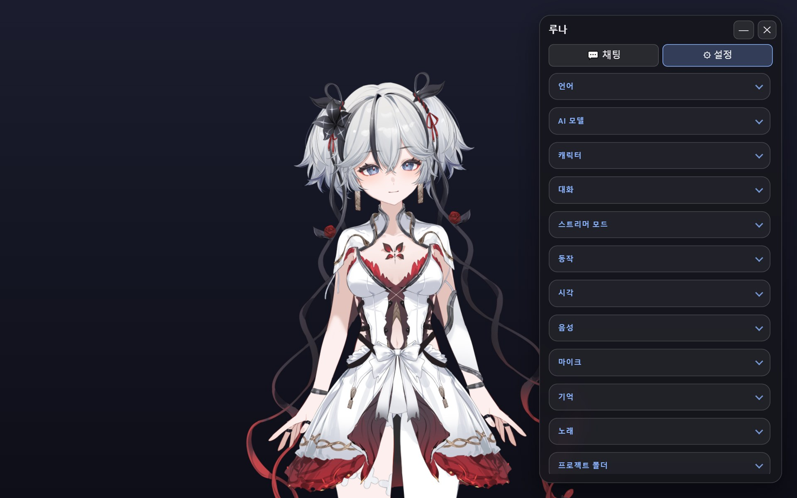
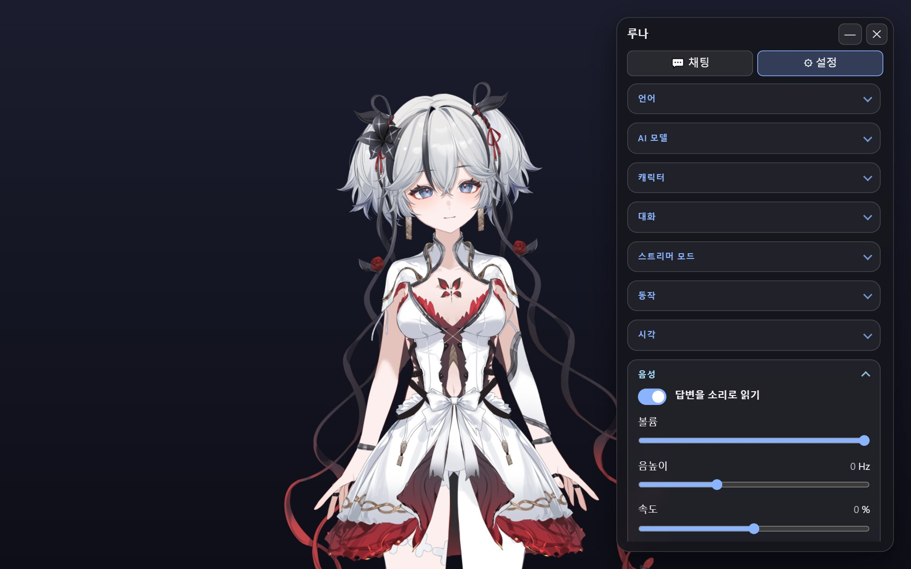

# 🌙 설정 안내

> 설정 탭의 모든 항목이 무엇을 하는지, 기본값은 무엇인지, 재시작해도 남는 것은 무엇인지 화면에 보이는 이름 그대로 정리했어요.

설정은 화면 오른쪽 패널의 **⚙ 설정** 탭에 있어요. 항목 이름은 앱 언어를 **한국어**로 했을 때 보이는 이름이에요. (섹션은 화면에 나오는 순서대로 적었어요.)

## 목차

- [한눈에 보기: 기본값과 기억되는 것](#한눈에-보기-기본값과-기억되는-것)
- [언어](#언어)
- [AI 모델](#ai-모델)
- [캐릭터](#캐릭터)
- [대화](#대화)
- [스트리머 모드](#스트리머-모드)
- [동작](#동작)
- [시각](#시각)
- [음성](#음성)
- [마이크](#마이크)
- [기억](#기억)
- [노래](#노래)
- [프로젝트 폴더](#프로젝트-폴더)
- [루나의 공간](#루나의-공간)
- [기록](#기록)
- [업데이트](#업데이트)
- [설정 파일로만 바꾸는 것](#설정-파일로만-바꾸는-것)
- [설정은 어디에 저장되나요?](#설정은-어디에-저장되나요)

## 한눈에 보기: 기본값과 기억되는 것

| 구분 | 내용 |
|---|---|
| 기억되는 것 | 앱 언어, 모델, 크기, 배경, 마우스로 옮기기, 루나가 먼저 말 걸기, 생생한 대화, 동작, 마우스·키보드 사용, 업무 모드, 카메라, 화면 보기, 보거나 듣는 것 알아채기, 소리로 노래 알아보기, 컴퓨터에서 나는 소리 듣기, 시선이 커서를 따라감, 답변 소리, 볼륨, 음높이, 속도, 음성 엔진, 언어별 고유 음성, 음성 인식 언어, 버튼 없이 대화, 음성으로 끊기, Twitch 채널 이름, 패널을 닫았는지·최소화했는지, 아바타 위치, 설정 안내를 이미 봤는지 |
| 기억되지 않는 것 | **스트리머 모드의 켜짐 상태** (실행할 때마다 꺼져 있어요) |
| 선택한 AI와 키 | 설정 화면 값과는 따로, 데이터 폴더의 `providers.json`과 `keys.dat`에 저장돼요 |

> **모든 스위치는 마지막 상태 그대로 돌아와요.** 예전에는 카메라나 화면 보기가 재시작할 때마다 꺼졌지만, 지금은 켜 둔 채로 종료하면 다시 켜져요. 처음 켤 때 한 번 받은 확인 창은 다시 묻지 않아요. 카메라나 마이크를 쓸 수 없으면 그 스위치는 꺼지고, 상태 줄에 이유가 나와요.

---

## 언어

| 항목 | 설명 | 기본값 |
|---|---|---|
| **앱 언어** | 화면의 모든 글자와 루나가 대화하는 주 언어를 바꿔요. English · Русский · 한국어 · 日本語 중에서 골라요. 루나는 모든 언어를 알아서, 언제든 번역이나 다른 언어로의 전환을 부탁할 수 있어요. | English (처음 설정 안내에서 고르게 돼요) |

앱 언어를 바꾸면 성장 페이지 같은 화면도 함께 바뀌고, 음성 인식 언어도 그에 맞춰져요(따로 바꿀 수도 있어요).

## AI 모델

루나가 무엇으로 생각할지 고르는 곳이에요. 자세한 방법은 [설치 및 시작의 5장](설치-및-시작.md#5-ai신경망-고르기)을 보세요.

| 항목 | 설명 |
|---|---|
| **루나가 사용할 AI** | 목록에서 `온라인 (키 필요)`(Z.ai (GLM), OpenAI, Anthropic (Claude), Google Gemini, OpenRouter)이나 `이 컴퓨터`(Ollama, LM Studio, Jan, llama.cpp server)를 골라요. |
| 상태 줄 | `연결됨. 키가 이 컴퓨터에 저장돼 있어요 (…마지막4자리).`, `연결됨. 이 컴퓨터에서 실행되며 밖으로 아무것도 나가지 않아요.`, `실행 중 아님` 등을 보여 줘요. |
| **키 변경** / **키 삭제** | 저장된 키를 바꾸거나 지워요. 지우면 다음에 다시 입력해야 해요. (키를 저장한 서비스에만 보여요.) |
| **키는 어디서 받나요** | 해당 서비스의 키 발급 페이지로 가는 링크예요. |
| **모델** | 연결된 AI의 모델을 골라요. 온라인 서비스는 목록을 서비스에서 받아 와요. 모델마다 `추천`, `빠름`, `균형`, `똑똑함`, `무료`, `그림 인식` 중 해당하는 설명이 붙어요. |
| **의미 이해하기 (어조와 기억)** | Google Gemini나 OpenAI를 골랐을 때만 나타나요. 켜면 메시지와 루나가 기억하는 사실·대화 조각이 숫자로 바꾸기 위해 같은 서비스로 전송돼요. 기본은 **꺼짐**이에요. 켜야 말의 *뜻*으로 어조를 읽고 기억을 떠올려요. |
| **설치해 볼 만한 모델** | Ollama일 때 보여요. 추천 모델의 대략적인 크기와 필요한 메모리, 설치 명령(`ollama pull …`)이 나오고 `복사` 버튼이 있어요. 앱이 자동으로 받지는 않아요. |
| **로컬 AI 찾기** | 이 컴퓨터에서 로컬 AI 프로그램을 찾아요. 실행 중이면 "연결할까요?"라고 물어요(`연결`/`나중에`). 설치만 되어 있고 실행 중이 아니면 안내해 줘요. 앱을 시작할 때도 자동으로 한 번 찾아요. |
| **설정 안내** | 처음 실행 때 나왔던 3단계 안내(언어 → AI → 팁)를 다시 열어요. |

**기억되는 것**: 선택한 AI, 모델, 키(암호화), `의미 이해하기` 선택. 키는 화면에 다시 나오지 않고 마지막 4자리만 보여 줘요.

## 캐릭터

| 항목 | 설명 | 기본값 / 범위 |
|---|---|---|
| **모델** | `assets/models`에 있는 Live2D 모델 중에서 골라요. 모델이 없으면 "assets/models에서 모델을 찾을 수 없어요"라고 나와요. | 마지막으로 고른 모델 |
| **크기** | 아바타의 크기 | 1.8 (1 ~ 6) |
| **배경** | `밤` / `낮` / `녹색 (캡처용)`. 녹색은 방송 캡처에서 배경을 지우기 쉽게 하려는 용도예요. 루나는 배경이 바뀐 것에 반응하기도 해요. | 밤 |
| **마우스로 루나 옮기기** | (데스크톱 창만) 원하는 자리에 세웠다면 꺼 두세요. 게임 중에 실수로 끌고 가는 일을 막아 줘요. | 켜짐 |

## 대화

| 항목 | 설명 | 기본값 |
|---|---|---|
| **루나가 먼저 말 걸기** | 실행할 때 인사하고, 오래 조용하면 말을 걸어요. 사용자가 입력하거나 말하는 중에는 끼어들지 않아요. 끄면 사용자가 말해야만 대답해요. 화면·소리·창 제목을 알아채는 기능들도 이 스위치가 켜져 있어야 해요. | 켜짐 |
| **생생한 대화** | 방 안에 있는 사람처럼: 조용할 때 더 자주 말을 걸지만, 질문에 답이 없으면 재촉하지 않고 침묵을 받아들여요. | 꺼짐 |

## 스트리머 모드

방송 진행을 돕는 모드예요. 루나가 함께 진행해요: 채팅에 답하고, 팔로우와 후원에 고마워하고, 침묵을 채워요. **손, 화면, 개인 기억은 쓰지 않아요.**

| 항목 | 설명 |
|---|---|
| **Twitch 채널 (선택)** | 채널 이름(영문, 숫자, `_`)을 넣으면 계정 없이 익명으로 채팅을 읽어요. 비워 두면 직접 입력해서 쓸 수 있어요. |
| **방송 시작** / **방송 종료** | 켤 때 확인 창이 떠요. 채팅 메시지(링크, 욕설, 명령 시도는 걸러져요)가 선택한 AI로 전달된다는 내용이에요. |
| `방송 중`, `대기: N` | 현재 상태와 대기 중인 메시지 수예요. |
| **시청자 이름** / **채팅 메시지 (또는 금액)** / **채팅에 보내기** | (방송 중에 나타나요) 직접 채팅 메시지를 넣어 볼 수 있어요. |
| **팔로우** / **구독** / **후원** / **레이드** | 이벤트를 직접 발생시켜 루나가 고마워하게 해요. |

기본값은 **꺼짐**이고, **실행할 때마다 꺼져 있어요.** (채널 이름만 기억돼요.)

## 동작

루나가 컴퓨터에서 실제로 할 수 있는 일을 정해요. 어떤 경우든 파일 쓰기, 명령 실행 같은 일은 **확인 카드를 눌러야만** 실행돼요. 자세한 설명은 [사용법과 기능의 9~10장](사용법-기능.md#9-손-사이트-열기-마우스와-키보드-명령-실행)에 있어요.

| 항목 | 설명 | 기본값 |
|---|---|---|
| **루나가 사이트와 프로그램을 열 수 있어요** | "구글 열어줘", "메모장 실행해줘"처럼 부탁해 보세요. `actions.json`에 있는 것과 이 컴퓨터에서 찾은 것만, 그리고 허용(카드)을 누른 뒤에만 열려요. 인터넷 검색과 환율, 컴퓨터 상태 확인도 이 스위치가 켜져 있어야 해요. 업무 모드도 이것을 바탕으로 해서, 이것이 꺼져 있으면 업무 모드도 작동하지 않아요. | 켜짐 |
| **루나가 마우스와 키보드를 사용할 수 있게 하기** | (데스크톱 창만) 화면을 보며 단계별로 작업을 해요("메모장 열고 목록 써줘"). 작업마다 시작을 눌러야 하고, 전송·결제·삭제는 한 번 더 확인해요. 중지: 버튼, `Ctrl+Alt+K`, 또는 마우스를 움직이기. 이미지는 선택한 AI로 전송돼요. 켤 때 확인 창이 떠요. | 꺼짐 |
| **업무 모드** | 개발자·사무 도우미: 코드 읽기와 수정, 명령 실행, 새 프로젝트, 게임 엔진, 로그, 문서. 평소 대화가 그냥 대화로 남도록 기본은 꺼져 있어요. 파일 수정, 명령, 문서는 여전히 눌러야 실행돼요. | 꺼짐 |

> 스트리머 모드가 켜져 있는 동안에는 이 스위치와 상관없이 손이 꺼져 있어요.

## 시각

보고 듣는 기능들이에요. **모두 켜기 전에 확인 창**이 떠요.

| 항목 | 설명 | 기본값 | 데스크톱만 |
|---|---|---|---|
| **카메라** | 루나가 당신의 위치를 보고, 미소와 자리를 비우거나 돌아오는 것을 알아채요. 영상은 컴퓨터에서만 처리되며 어디에도 전송되지 않아요. 켜 두면 화면 구석에 작은 창과 표시등이 떠요. 카메라를 쓸 수 없으면 이유를 상태 줄에 보여 줘요. | 꺼짐 | 아니요 |
| **화면 보기** | 루나가 가끔 화면을 보고 생각을 나눠요 (`생생한 대화` 필요). 이미지는 선택한 AI로 전송되며 저장되지 않아요. 빠른 끄기: `Ctrl+Alt+L`. | 꺼짐 | 예 |
| **보거나 듣는 것 알아채기** | 활성 창의 제목(영화, 애니, 영상, 노래)만 읽고 이야기할 수 있어요. 화면도 소리도 저장하지 않아요. `루나가 먼저 말 걸기`가 켜져 있어야 해요. | 꺼짐 | 예 |
| **컴퓨터에서 나는 소리 듣기** | 20초마다 루나가 몇 초 동안 스피커 소리를(마이크는 절대 아님) 듣고 이 컴퓨터에서 이해해요. 소리는 저장되거나 전송되지 않고, 이야기할 때 짧은 글 메모만 선택한 AI로 갈 수 있어요. 통화와 메신저는 건너뛰어요. 처음 켤 때 음성 모델(약 45MB)을 받아요. | 꺼짐 | 예 |
| **소리로 노래 알아보기** | "이 노래 뭐야?"라고 묻고 청각이 켜져 있으면, 이 컴퓨터에서 약 10초 분량 소리의 디지털 지문을 만들어 그 지문만(소리 자체는 아님) Shazam 서비스로 보내요. | 꺼짐 | 예 |
| **시선이 커서를 따라감** | 끄면 신경망이 시선과 머리를 조종해요. | 꺼짐 | 아니요 |

> `화면 보기`, `보거나 듣는 것 알아채기`, `컴퓨터에서 나는 소리 듣기`, `소리로 노래 알아보기`는 **데스크톱 창에서만** 보여요. 화면 캡처와 창 제목 읽기는 Electron 껍데기가 맡기 때문이에요.
>
> **`컴퓨터에서 나는 소리 듣기`**를 쓰려면 `soundcard`와 `vosk` 패키지가 필요해요 (`install.bat`이 설치해요). 없으면 "청각이 설치되지 않았어요"라고 알려 줘요.

## 음성

| 항목 | 설명 | 기본값 / 범위 |
|---|---|---|
| **답변을 소리로 읽기** | 끄면 글자로만 답해요. | 켜짐 |
| **볼륨** | 목소리 크기 | 1 (0 ~ 1) |
| **음높이** | 목소리 높이(Hz) | 0 (-50 ~ +100) |
| **속도** | 말하는 속도(%) | 0 (-50 ~ +50) |
| **음성 엔진** | `클라우드 음성 (최고 품질)` / `클라우드, 실패하면 Windows 음성` / `Windows 음성만 (오프라인)`. 클라우드 음성은 말할 텍스트를 Microsoft로 보내요. Windows 음성은 컴퓨터 안에 머물지만 소리가 단순하고 Windows에 설치된 언어만 지원해요. 해당 언어의 Windows 음성이 없으면 그 언어는 소리가 나지 않아요. | 클라우드 음성 |
| **언어별 고유 음성** | 러시아어와 한국어는 각 언어의 음성으로 읽어요. 강세와 억양이 더 자연스럽지만 음색이 기본 음성과 달라요. | 꺼짐 |
| **🔊 음성 테스트** | 샘플 문장을 읽어 봐요. | - |

> 러시아어와 한국어 발음이 어색하면 `언어별 고유 음성`을 켜 보세요. 강세와 억양은 더 자연스러워지지만 음색은 기본 음성과 달라져요.

## 마이크

| 항목 | 설명 | 기본값 |
|---|---|---|
| **음성 인식 언어** | English / Русский / 한국어 / 日本語. 앱 언어를 따라가고, 따로 바꿀 수도 있어요. | 앱 언어에 맞춤 |
| **버튼 없이 대화** | 마이크가 항상 듣고 있어요. | 꺼짐 |
| **음성으로 루나의 말을 끊기** | 헤드폰이 필요해요. 아니면 루나가 자기 목소리를 들어요. 클릭하거나 `Esc` 키로도 멈출 수 있어요. | 꺼짐 |
| **🎤 마이크 테스트** | 말을 해 보면 입력이 들어오는지, 인식이 되는지, 소리가 너무 작은지 알려 줘요. | - |

안내문에 있듯이 음성 인식은 **브라우저 버전에서는 Chrome 또는 Edge**에서만 되고 인터넷을 써요. 데스크톱 창에서는 이 컴퓨터에서 직접 인식해요(처음에는 음성 모델을 내려받아요).

## 기억

| 항목 | 설명 |
|---|---|
| **새 대화 (기억은 유지)** | 화면의 대화를 새로 시작해요. 기억은 그대로예요. |
| **루나의 성장 페이지** | 새 탭에서 성장 페이지를 열어요: 나이, 만남과 메시지 수, 기분, 일기, 관심사, 기억하는 사실, 우리의 대화, 변해 온 과정. 항목마다 `잊게 하기`로 하나씩 지울 수 있어요. |
| **루나의 기억 지우기** | 루나가 당신과 자신에 대해 기억한 모든 것을 지워요(확인 창이 떠요). 되돌릴 수 없어요. |

## 노래

| 항목 | 설명 |
|---|---|
| **노래 추가...** | mp3, wav, ogg, flac, m4a 파일을 추가해요(파일당 80MB, 최대 60곡). 파일은 이 컴퓨터에만 있어요. 추가한 노래는 목록에 `재생`/`삭제` 버튼과 함께 나와요. 제목으로 "불러줘"라고 부탁하면 그 녹음을 재생하고 루나가 입을 맞추고 춤을 춰요. |
| **루나 목소리 커버 추가...** | 루나의 목소리로 만든 커버 곡을 추가해요(`studio/Luna_cover.ipynb`와 `studio/make_reference.py` 사용). 이렇게 추가한 곡은 `♪`로 표시되고, 루나가 직접 부른다는 걸 알게 돼요. 고급 기능이라 기본 사용에는 필요 없어요. |
| **중지** | 노래를 멈춰요. |

## 프로젝트 폴더

루나가 **기존 프로젝트에 새 파일을 추가해도 되는 폴더**를 정하는 곳이에요. 기본값은 **비어 있고**, 그러면 루나는 자기 `문서\Luna\Projects` 폴더에만 프로젝트를 만들어요.

| 항목 | 설명 |
|---|---|
| 폴더 경로 입력란 | 예: `D:\Games\MyGame`. 드라이브 전체가 아니라 **한 프로젝트의 폴더**를 넣으세요. |
| **이 폴더 허용** | 목록에 추가해요(최대 8개). 이후 루나는 그 프로젝트 안의 파일 목록(최대 60개, 비밀·숨김 제외)을 보고 **새 파일**을 제안할 수 있어요. |
| **제거** | 허용을 바로 취소해요. |

규칙은 항상 같아요. 파일 묶음을 먼저 모두 보여 주고 **적용**을 눌러야 하며, 덮어쓰지 않고, 기록에서 되돌릴 수 있어요. 드라이브 루트, 홈 폴더, 문서·바탕 화면·다운로드 폴더 전체, 시스템 폴더, AppData, 앱 자신의 폴더는 허용되지 않아요.

## 루나의 공간

루나가 스스로 쓰는 기록이에요: 일기, 생각, 스케치. 여기서는 **읽기만** 가능해요. 폴더는 `문서\Luna\Nook`이에요.

| 항목 | 설명 |
|---|---|
| **기록 보기** / **기록 숨기기** | 글 목록을 펼치거나 접어요. 비어 있으면 "아직 비어 있어요. 아무것도 쓰지 않았어요."라고 나와요. `목록으로` 버튼으로 돌아와요. |

## 기록

루나가 이 컴퓨터에서 **실제로 한 일과 시각**이에요. 사용자가 허락한 뒤 한 일만 기록되고, 대화와 키는 기록되지 않아요.

| 항목 | 설명 |
|---|---|
| **기록 보기** / **기록 숨기기** | 목록을 펼치거나 접어요. |
| **되돌리기** | 되돌릴 수 있는 항목(문서 생성은 휴지통으로, 코드 수정은 백업 복원, 파일 이동 되돌리기, 새 프로젝트 삭제 등)에만 나타나요. 사이트·프로그램 열기와 마우스 작업은 되돌릴 수 없어서 버튼이 없어요. 그 뒤에 파일이 바뀌었다면 사용자의 작업을 지키려고 되돌리지 않아요. |
| **기록 지우기** | 기록을 모두 지워요(확인 창이 떠요). 지우면 루나의 행동을 더 이상 추적할 수 없게 돼요. |

기록은 최대 1000개까지 보관돼요.

## 업데이트

설정 맨 아래에 있어요. 자세한 설명은 [설치 및 시작의 8장](설치-및-시작.md#8-업데이트-삭제-정리)을 보세요.

| 항목 | 설명 |
|---|---|
| **업데이트 확인** | 업데이트 채널에 새 버전이 있는지 물어봐요. 채널(`update_feed`)이 `settings.json`에 없으면 "업데이트 채널이 없어요"라고 나오고 아무 네트워크도 쓰지 않아요. |
| **설치** | 새 버전이 있을 때만 나타나요. 누르면 확인 후 프로그램 파일을 교체해요. 체크섬이 맞지 않거나 버전이 다르면 설치하지 않아요. 설치 후에는 루나를 다시 시작하세요. |
| **되돌리기** | 이전 버전으로 돌아가요. |

## 설정 파일로만 바꾸는 것

화면에는 없고 프로젝트 폴더의 `settings.json`으로만 바꾸는 항목이에요. 바꾼 뒤에는 **재시작**이 필요해요.

| 키 | 설명 |
|---|---|
| `personality` | 루나의 성격 설명문(AI에게 주는 지시). |
| `update_feed` | 업데이트 채널 주소(`https://…/luna.json`). 기본은 비어 있어요. |
| `embeddings` | (고급) 로컬 임베딩을 쓰고 싶을 때, 예: `"ollama:nomic-embed-text"`. 클라우드 서비스로 의미 이해를 쓰려면 화면의 `의미 이해하기` 스위치를 쓰세요. |

또 `actions.json`(데이터 폴더)은 루나가 열 수 있는 사이트·프로그램 목록이에요. 항목은 `kind`가 `url`(사이트) 또는 `app`(프로그램, `steam://rungameid/ID` 형태도 가능)이어야 해요. 처음 실행하면 `actions.example.json`에서 복사돼요.

## 설정은 어디에 저장되나요?

- 화면의 스위치와 값은 `%APPDATA%\Luna\ui-state.json`에 저장돼요. 서버가 페이지와 함께 이 값을 돌려주기 때문에 데스크톱 창이 매번 새 주소로 열려도 잊어버리지 않아요.
- 선택한 AI와 키는 `providers.json`, `keys.dat`(암호화)에 저장돼요.
- 모든 개인 데이터는 프로젝트 폴더 밖의 `%APPDATA%\Luna`에 있고, 환경 변수 `LUNA_DATA_DIR`로 위치를 바꿀 수 있어요. ([설치 및 시작의 7장](설치-및-시작.md#7-내-데이터는-어디에-있나요))

---

[설치 및 시작](설치-및-시작.md) · [사용법과 기능](사용법-기능.md) · [동작 원리](동작-원리.md)

[← 처음으로 돌아가기 (README)](../../README.md)
