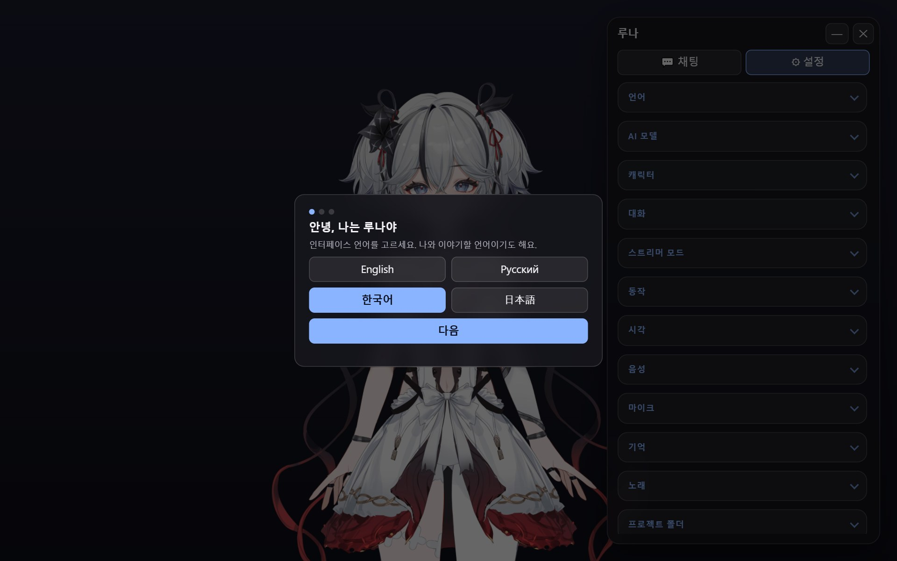

# 🌙 설치 및 시작

> 프로그래밍을 몰라도 따라 할 수 있도록, 설치부터 첫 대화까지 차근차근 안내해요.

## 목차

1. [준비물](#1-준비물)
2. [설치하기 (install.bat)](#2-설치하기-installbat)
3. [실행하기](#3-실행하기)
4. [처음 실행하면 나오는 설정 안내](#4-처음-실행하면-나오는-설정-안내)
5. [AI(신경망) 고르기](#5-ai신경망-고르기)
6. [Live2D 모델 넣기](#6-live2d-모델-넣기)
7. [내 데이터는 어디에 있나요?](#7-내-데이터는-어디에-있나요)
8. [업데이트, 삭제, 정리](#8-업데이트-삭제-정리)
9. [문제가 생겼을 때](#9-문제가-생겼을-때)

---

## 1. 준비물

| 필요한 것 | 설명 |
|---|---|
| Windows 10 또는 11 | 다른 운영체제는 지원하지 않아요. |
| Python 3.10 이상 | 없으면 설치 도우미가 winget으로 Python 3.12를 설치해 줘요. (winget이 없으면 직접 설치하는 방법을 알려 줘요.) |
| 인터넷 연결 | 라이브러리 설치와 온라인 AI, 음성 출력(edge-tts)에 필요해요. 로컬 AI와 "Windows 음성만" 모드를 쓰면 대화는 컴퓨터 밖으로 나가지 않아요. |
| Chrome 또는 Edge | 브라우저 버전(`start.bat`)에서 마이크를 쓸 때 필요해요. |
| AI 하나 | 온라인 서비스의 키, 또는 이 컴퓨터에서 돌리는 로컬 AI. [5장](#5-ai신경망-고르기)을 보세요. |
| Live2D 모델 | **이 저장소에는 들어 있지 않아요.** [6장](#6-live2d-모델-넣기)을 보세요. |

데스크톱 창(Electron)으로 실행하려면 Node.js도 필요한데, 설치 도우미가 함께 설치해 줘요.

## 2. 설치하기 (install.bat)

프로젝트 폴더에서 `install.bat`을 **더블클릭**하면 돼요. 처음 한 번만 하면 되고, 다시 실행해도 안전해요. 이미 설치된 것은 건드리지 않아요.

```text
install.bat                 # 전체 설치
install.bat --check         # 확인만 해요. 아무것도 설치하거나 바꾸지 않아요
install.bat --lang ko       # 메시지 언어를 직접 고르기 (ko, en, ru, ja)
```

### 언어

설치 도우미는 한국어, English, Русский, 日本語로 안내해요. 기본은 **Windows 표시 언어**를 따라가고, 이 네 가지가 아니면 영어로 나와요. `--lang ko`처럼 직접 고를 수도 있어요.

### 무엇을 설치하나요?

| 단계 | 하는 일 |
|---|---|
| Python | 3.10 이상인지 확인하고, 없으면 winget으로 Python 3.12를 설치해요. |
| Python 라이브러리 | `requirements.txt`에 적힌 라이브러리(음성, Word·PowerPoint·Excel 문서, PDF 읽기, 음성 인식 등)를 pip로 설치해요. |
| Node.js와 Electron | 데스크톱 창에 필요해요. 없으면 winget으로 Node.js(LTS)를 설치하고, Electron(약 100MB)을 받아요. |
| 프로젝트 파일 | 꼭 필요한 파일이 모두 있는지 확인해요. |
| Live2D 모델 | `assets/models`에 모델이 몇 개 있는지 세어서 알려 줘요. 없으면 "아바타가 나오지 않는다"고 알려 줘요. |
| 아바타용 오프라인 라이브러리 | `web/vendor/`에 받아 두어서 인터넷 없이도 화면이 열려요. 못 받으면 페이지를 열 때 인터넷에서 불러와요. |
| 인터넷 접속 확인 | 아바타 라이브러리를 내려받는 주소에 닿는지 확인해요. |
| 로컬 AI(Ollama) | **설치하지 않고**, 있는지만 알려 줘요. |

끝나면 "준비 완료"와 실행 방법이 나오고, 아직 안 된 항목이 있으면 목록으로 보여 줘요. 고친 뒤 `install.bat`을 다시 실행하면 돼요.

> **개인 데이터는 건드리지 않아요.** 설치 도우미는 프로그램과 라이브러리만 설치하고, 기억·키·기록은 만지지 않아요.

### ❗ Ollama는 설치하지 않아요

로컬 AI(내 컴퓨터에서 돌아가는 AI)를 쓰고 싶다면 [ollama.com](https://ollama.com)에서 **직접** 설치하세요. 설치 도우미는 Ollama가 있는지 확인해서 알려 주기만 해요. 로컬 AI가 필요 없다면 온라인 AI의 키를 붙여 넣는 방법만으로도 충분해요.

### 설치 중 자주 만나는 상황

- Windows가 "허용하시겠습니까?" 하고 물으면 **예**를 눌러 주세요.
- Python이나 Node.js를 방금 설치했는데 창이 인식하지 못한다고 하면, 창을 닫고 `install.bat`을 **다시 실행**해 주세요.
- pip가 라이브러리를 받지 못하면 인터넷, VPN, 프록시, 백신을 확인한 뒤 다시 실행하세요.

## 3. 실행하기

| 파일 | 실행 방식 |
|---|---|
| `start.bat` | 서버를 시작하고 **브라우저**(기본 브라우저)에서 루나를 열어요. |
| `start-desktop.bat` | **데스크톱 창(Electron)**: 배경이 투명한 창으로 화면 위에 루나가 서 있어요. |

두 방식 모두 **검은 창(콘솔)을 닫지 마세요.** 그 창이 루나의 서버예요. 끝내려면 창을 닫거나 `Ctrl+C`를 누르면 돼요.

### 브라우저 버전과 데스크톱 버전의 차이

| | 브라우저 (`start.bat`) | 데스크톱 (`start-desktop.bat`) |
|---|---|---|
| 모양 | 일반 브라우저 탭 | 투명한 창, 빈 곳은 클릭이 통과해요 |
| 음성 입력 | 브라우저 내장 음성 인식(Chrome/Edge, 인터넷 사용) | 서버가 이 컴퓨터에서 직접 인식해요 (Vosk, 한국어·일본어는 sherpa-onnx 사용) |
| 화면 보기, 창 제목 읽기, 컴퓨터 소리 듣기, 노래 알아보기 | 없어요 | 있어요 (설정에서 켜요) |
| 마우스·키보드 사용 | 없어요 | 있어요 (기본 꺼짐, 설정에서 켜요) |
| 트레이 아이콘 | 없어요 | 있어요 (초승달 아이콘) |

데스크톱 창의 단축키예요.

| 단축키 | 동작 |
|---|---|
| `Ctrl+Alt+H` | 루나를 트레이로 숨기거나 다시 불러와요 |
| `Ctrl+Alt+L` | 화면 보기를 바로 끄기 |
| `Ctrl+Alt+K` | 마우스·키보드 작업을 즉시 중지 |
| `Ctrl+Alt+Q` | 루나 종료 |

데스크톱 버전을 처음 실행하면 Electron이 설치되어 있지 않을 때 자동으로 설치해요. Node.js가 없으면 데스크톱 창은 열리지 않지만, `start.bat`의 브라우저 버전은 그대로 쓸 수 있어요. 데스크톱 창이 안 열리면 데이터 폴더의 `shell.log`에 이유가 남아 있어요.

### 주소와 포트

서버는 `127.0.0.1`의 **47615번 포트**를 써요. 내 컴퓨터에서만 열리고 다른 컴퓨터에서는 접속할 수 없어요. 이 포트가 이미 사용 중이면 비어 있는 다른 포트를 자동으로 골라요. 검은 창에 나오는 `Open:` 뒤의 주소가 실제 주소예요.

### 음성 인식 모델 내려받기

데스크톱 버전에서 마이크나 "컴퓨터에서 나는 소리 듣기"를 처음 켜면, 작은 음성 모델(약 45MB 이상)을 한 번 내려받아요. 한국어는 SenseVoice 모델(약 160MB)을 쓰고, 프로젝트 폴더의 `models/`에 저장돼요. 진행 상황은 화면의 상태 줄에 나와요.

## 4. 처음 실행하면 나오는 설정 안내

연결된 AI가 없으면 처음 실행할 때 **설정 안내** 창이 자동으로 떠요. 세 단계예요.

<div align="center">

</div>

1. **"안녕, 나는 루나야"**: 인터페이스 언어를 골라요. 루나와 이야기할 언어이기도 해요. (한국어 / English / Русский / 日本語)
2. **"무엇으로 생각할까요?"**: AI를 골라요.
   - 이 컴퓨터에서 로컬 AI가 실행 중이면 **이 컴퓨터** 아래에 나타나요.
   - **온라인 (키 필요)** 아래의 서비스를 누르면 키 입력란이 나와요.
3. **"준비 완료"**: 알아두면 좋은 것 세 가지를 보여 주고, **대화 시작**을 누르면 루나가 인사해요.

중간에 **나중에**를 누르면 설정 탭으로 넘어가요. 이 안내는 한 번만 나오고, 나중에 다시 보고 싶으면 **설정 → AI 모델 → 설정 안내** 버튼을 누르면 돼요.

## 5. AI(신경망) 고르기

**설정 → AI 모델 → 루나가 사용할 AI**에서 골라요. 둘 중 하나예요.

| 종류 | 목록 | 특징 |
|---|---|---|
| **온라인 (키 필요)** | Z.ai (GLM), OpenAI, Anthropic (Claude), Google Gemini, OpenRouter | 키를 한 번 입력하면 다음부터 자동으로 연결돼요. 메시지(와 허락한 경우 화면 이미지)가 그 서비스로 전송돼요. |
| **이 컴퓨터** | Ollama, LM Studio, Jan, llama.cpp server | 대화가 컴퓨터 밖으로 나가지 않아요. 프로그램을 먼저 실행해 두어야 해요. |

### 키 입력하기

1. 온라인 서비스를 고르면 키 입력창이 떠요. **키는 어디서 받나요** 링크로 해당 서비스의 키 발급 페이지로 갈 수 있어요.
2. 키를 붙여 넣고 **저장**을 누르면 서비스에 확인한 뒤 저장해요. 취소하면 아무것도 바뀌지 않아요.
3. 저장된 키는 **Windows DPAPI**로 암호화돼요. 이 Windows 사용자 계정, 이 컴퓨터에서만 열 수 있어요. 화면에는 마지막 4자리만 보여 주고, 로그와 오류 메시지에도 들어가지 않아요.
4. 나중에 **키 변경**, **키 삭제** 버튼으로 바꾸거나 지울 수 있어요.

### 로컬 AI 연결하기

- 로컬 AI 프로그램(예: Ollama)을 먼저 **실행**하세요.
- 앱이 시작할 때 자동으로 찾아서 "연결할까요?" 하고 물어봐요. 못 찾았다면 **로컬 AI 찾기** 버튼을 누르세요.
- 프로그램은 설치되어 있지만 실행 중이 아니면 "실행한 뒤 '로컬 AI 찾기'를 누르세요"라고 알려 줘요.
- Ollama를 쓰는 경우 **설치해 볼 만한 모델** 목록에서 명령어(`ollama pull …`)를 복사해 터미널에서 실행할 수 있어요. 앱이 대신 내려받지는 않아요.

### 모델 고르기

연결하면 **모델** 목록이 나타나요. 모델마다 "추천 / 빠름 · 균형 · 똑똑함 / 무료 / 그림 인식" 같은 짧은 설명이 붙어요. 알려지지 않은 모델은 설명 없이 나올 수 있어요. 카메라나 화면 이미지를 보게 하려면 **그림 인식**이 되는 모델이어야 해요. 그런 모델이 아니면 루나가 솔직하게 말해 줘요.

### 의미 이해하기 (선택)

Google Gemini나 OpenAI를 고르면 **의미 이해하기 (어조와 기억)** 스위치가 나타나요. 기본은 꺼짐이에요. 켜면 메시지와 루나가 기억하는 사실·대화 조각이 숫자로 바꾸기 위해 같은 서비스로 전송돼요. 이 스위치로 어조와 기억 떠올리기를 의미 기반으로 할 수 있어요.

## 6. Live2D 모델 넣기

> ⚠️ **이 저장소에는 Live2D 모델이 들어 있지 않아요.** 모델은 각 제작자의 저작물이고, 저장소 스크린샷의 모델은 시연용이에요. 반드시 **사용 권한이 있는 모델**을 쓰세요. 자세한 내용은 [NOTICE](../../NOTICE)를 확인하세요.

### 모델은 어디에 넣나요?

`assets/models/` 폴더 아래에 모델 폴더를 통째로 넣으면 돼요.

```text
assets/models/
└─ 내모델/
   └─ (모델 폴더)/
      ├─ xxx.model3.json
      ├─ xxx.moc3
      ├─ textures/ ...
      └─ ...
```

- 앱은 `assets/models/` 안에서 `*.model3.json` 파일을 모두 찾아요 (하위 폴더까지).
- `.moc3`, 텍스처, 물리 파일이 하나라도 빠져 있으면 그 모델은 목록에서 빠져요. 압축을 풀 때 파일 이름이 깨졌는지 확인해 보세요.
- 넣은 뒤 페이지를 새로고침하면 **설정 → 캐릭터 → 모델**에서 고를 수 있어요.
- 음성 인식 모델은 `assets/models/`가 아니라 프로젝트 폴더의 `models/`(`vosk`, `sherpa`)에 따로 저장돼요. 섞지 마세요.

### 모델은 어디서 구하나요?

**BOOTH**에서 무료 Live2D 모델을 찾아볼 수 있어요.

- 🔗 <https://booth.pm/en/search/free%20live2d>

BOOTH에는 **무료 모델과 유료 모델이 함께** 있어요. 받기 전에 꼭 **각 모델의 이용 약관(라이선스)을 확인**하세요. 예를 들어 재배포 금지, 상업적 방송 금지, 개작 금지 같은 조건이 붙어 있을 수 있어요. 약관이 허락하는 범위 안에서 사용하고, 받은 모델은 이 저장소에 올리지 마세요. (`assets/`는 저장소에 올리지 않도록 되어 있어요.)

## 7. 내 데이터는 어디에 있나요?

기억, 키, 기록, 설정은 프로젝트 폴더가 **아니라** 사용자 폴더에 저장돼요.

```text
%APPDATA%\Luna
```

탐색기 주소창에 `%APPDATA%\Luna`를 붙여 넣으면 열려요. 이렇게 하면 프로젝트 폴더를 복사하거나 공유해도 개인 데이터가 딸려 가지 않아요.

| 파일 / 폴더 | 내용 |
|---|---|
| `memory.json` | 루나의 기억 (당신에 대한 사실, 일기, 기분, 대화 조각) |
| `keys.dat` | 암호화된 API 키 (다른 컴퓨터로 옮겨도 열리지 않아요) |
| `providers.json` | 선택한 AI |
| `ui-state.json` | 설정 화면의 스위치와 값, 아바타 위치 |
| `journal.jsonl` | 루나가 컴퓨터에서 실제로 한 일의 기록 |
| `songs/` | 추가한 노래 |
| `edit_backups/` | 코드 수정 전 백업 |
| `actions.json` | 루나가 열 수 있는 사이트·프로그램 목록 (처음 실행할 때 `actions.example.json`에서 복사해요) |
| `lists.json`, `habits.json`, `manners.json`, `standup.json` | 목록, 습관, 말투 요청, 스탠드업 메모 |
| `shell.log` | 데스크톱 창의 실행 기록 (문제가 생겼을 때 확인해요) |

이 밖에 루나가 만든 문서는 **문서\Luna**, 새 프로젝트는 **문서\Luna\Projects**, 루나가 스스로 쓰는 기록은 **문서\Luna\Nook**에 생겨요.

### 위치 바꾸기

환경 변수 `LUNA_DATA_DIR`을 설정하면 데이터 폴더를 바꿀 수 있어요. 예를 들어 빈 데이터로 시험해 보고 싶다면 이렇게 해요.

```bat
set LUNA_DATA_DIR=C:\temp\luna-test
start.bat
```

예전 버전이 프로젝트 폴더 옆에 남긴 데이터 파일이 있으면, 처음 실행할 때 데이터 폴더로 옮겨져요. 이미 있는 파일은 덮어쓰지 않아요.

## 8. 업데이트, 삭제, 정리

### 업데이트

- **설정 맨 아래 → 업데이트 → 업데이트 확인**: 업데이트 채널이 설정되어 있을 때만 동작해요. 채널은 `settings.json`의 `"update_feed"`에 적는데, 기본은 비어 있어서 아무것도 확인하지 않아요. 채널이 없으면 "업데이트 채널이 없어요"라고 나와요.
- 채널이 있으면 새 버전을 확인한 뒤 **설치**를 눌러야 설치돼요. 설치 후에는 루나를 다시 시작해야 해요. 문제가 생기면 **되돌리기**로 이전 버전에 돌아갈 수 있어요.
- 업데이트는 프로그램 파일만 바꿔요. 데이터 폴더(`%APPDATA%\Luna`)와 `settings.json`, `web/vendor/`는 건드리지 않아요.
- 채널은 서명되지 않아요(무결성 검사만 해요). 믿을 수 있는 채널만 쓰세요.
- 업데이트 채널이 없다면 새 버전의 프로젝트 파일을 받아 덮어쓰면 돼요. 이때 `assets/models/`(내 모델)와 `settings.json`을 지우지 않게 주의하고, 덮어쓴 뒤 `install.bat`을 한 번 더 실행하세요. 데이터는 `%APPDATA%\Luna`에 있으므로 영향을 받지 않아요.

### 삭제하기

별도의 제거 프로그램은 없어요. 아래 순서로 지우면 돼요.

1. 루나를 종료해요 (`Ctrl+C` 또는 창 닫기, 데스크톱 버전은 트레이에서 **종료**).
2. 프로젝트 폴더를 삭제해요.
3. 기억과 기록까지 모두 지우고 싶다면 `%APPDATA%\Luna` 폴더도 삭제하세요. (지우면 기억을 되돌릴 수 없어요.)
4. 루나가 만든 문서가 필요 없다면 **문서\Luna** 폴더도 지워요.

설치할 때 함께 설치된 Python이나 Node.js는 Windows의 **설정 → 앱**에서 필요하면 따로 지우세요.

기억만 지우고 싶다면 **설정 → 기억 → 루나의 기억 지우기**를 써도 돼요.

### 정리하기 (tools/cleanup.py)

`tools/cleanup.py`는 **제거 프로그램이 아니라 "쓰레기 정리 도구"**예요. 아래의 불필요한 파일만 정리하고, 기억·키·기록·모델·문서·프로젝트는 건드리지 않아요.

| 정리 대상 | 설명 |
|---|---|
| Python 캐시 | `__pycache__` 폴더 |
| 받다 만 파일 | `models/` 안의 `.part`, `.tmp`, `.zip`, `.tar.bz2` 같은 다운로드 찌꺼기 |
| 오래된 로그 | 프로젝트 폴더의 7일 넘은 `*.log` |
| 임시 폴더 | 시스템 임시 폴더에 테스트가 남긴 `tmpxxxxxxxx` 폴더(하루 넘은 것) |

```bat
py tools\cleanup.py            :: 무엇이 지워질지, 얼마나 차지하는지만 보여 줘요 (지우지 않아요)
py tools\cleanup.py --apply    :: 실제로 지워요
```

## 9. 문제가 생겼을 때

코드와 문서에 실제로 있는 동작과 메시지를 기준으로 정리했어요.

| 증상 | 원인과 해결 |
|---|---|
| `install.bat`이 "Python 3.10 이상을 찾을 수 없어요"라고 해요 | winget이 있으면 Python 3.12를 자동으로 설치해요. 설치 후에도 창이 인식하지 못하면 창을 닫고 `install.bat`을 다시 실행하세요. |
| "자동 설치를 쓸 수 없어요 (winget 없음)" | winget이 없는 Windows예요. [python.org](https://www.python.org/downloads/)에서 Python을 받아 설치하고, 설치 화면에서 **Add python.exe to PATH**를 체크한 뒤 `install.bat`을 다시 실행하세요. |
| "pip가 라이브러리를 내려받지 못했어요" | 인터넷, VPN, 프록시, 백신을 확인하고 `install.bat`을 다시 실행하세요. |
| `"py" 런처를 찾지 못했어요` | `start.bat`은 `py`로 서버를 실행해요. python.org에서 Python을 다시 설치할 때 **py launcher**를 체크하세요. |
| Node.js / npm이 없다고 나와요 | 데스크톱 창(Electron)은 열리지 않지만 `start.bat`의 브라우저 버전은 동작해요. Node.js를 설치한 뒤 `install.bat`을 다시 실행하면 데스크톱 창도 쓸 수 있어요. |
| 포트 47615가 이미 사용 중이에요 | 문제없이 다른 빈 포트로 자동으로 열려요. 검은 창의 `Open:` 뒤 주소를 확인하세요. 루나를 두 번 실행한 건 아닌지 확인해 보세요. |
| 데스크톱 창이 열리지 않아요 | 오류 창이 뜨면 거기에 이유가 적혀 있어요. `%APPDATA%\Luna\shell.log`도 확인하세요. 라이브러리가 없다는 내용이면 `py -m pip install -r requirements.txt`를 실행하세요. |
| 아바타가 안 나와요 / "assets/models에서 모델을 찾을 수 없어요" | `assets/models/`에 모델이 없는 거예요. [6장](#6-live2d-모델-넣기)대로 모델 폴더를 넣고 새로고침하세요. |
| 모델 목록에 내 모델이 안 보여요 | 모델 폴더의 `.moc3`, 텍스처, 물리 파일이 빠졌을 수 있어요. 빠진 파일이 있으면 그 모델은 건너뛰어요. 압축을 다시 풀어 보세요. |
| 아바타 화면이 안 열려요 | 아바타 라이브러리(`web/vendor/`)가 없고 인터넷도 안 되면 그릴 수 없어요. 인터넷이 되는 곳에서 `py tools\fetch_vendor.py`를 실행하세요. |
| "연결된 AI가 없어요" | 설정에서 AI를 고르세요. [5장](#5-ai신경망-고르기)을 보세요. |
| "서비스가 이 키를 받아들이지 않았어요" | 키를 잘못 복사했거나(앞뒤 공백 포함) 만료된 키예요. **키 변경**으로 다시 입력하세요. |
| "계정에 결제가 필요하거나 잔액이 없어요" | 키는 맞지만 해당 서비스 계정에 잔액이나 무료 한도가 없어요. 서비스 쪽 결제·한도를 확인하세요. |
| "요청 한도에 도달했어요" | 잠시 기다렸다가 다시 해 보세요. |
| "모델을 찾을 수 없거나 요청이 거부됐어요" | 설정에서 다른 모델을 고르세요. |
| "서비스에 연결할 수 없어요 (또는 실행 중이 아니에요)" | 인터넷을 확인하세요. 로컬 AI라면 프로그램이 실행 중인지 확인하고 **로컬 AI 찾기**를 누르세요. |
| 로컬 AI가 목록에 안 나와요 | Ollama 등을 직접 설치·실행해야 해요. 설치 도우미는 설치하지 않아요. |
| 마이크가 안 돼요 ("마이크에 접근할 수 없어요") | 브라우저 주소창의 자물쇠 아이콘에서 마이크를 허용하세요. 마이크 사용은 Chrome이나 Edge에서 돼요. 설정의 **🎤 마이크 테스트**로 입력이 들어오는지 확인하세요. |
| "프로그램에 소리가 들어오지 않아요" | Windows 소리 설정에서 입력 장치와 마이크 음소거를 확인하세요. |
| 데스크톱에서 "음성 입력에는 패키지 두 개가 필요해요" | `py -m pip install soundcard vosk`를 실행하세요. |
| 루나가 말은 하는데 소리가 안 나요 | 브라우저는 페이지를 한 번 클릭하기 전에는 소리를 막아요(그동안은 글자로만 나와요). 페이지 아무 곳이나 클릭하세요. **설정 → 음성 → 답변을 소리로 읽기**가 켜져 있는지, 볼륨이 0이 아닌지도 확인하세요. |
| 음성이 아예 안 만들어져요 | 기본 음성 엔진은 인터넷이 필요해요. 설정의 **음성 엔진**을 "Windows 음성만 (오프라인)"으로 바꿔 보세요. 단, Windows에 해당 언어의 음성이 설치되어 있어야 하고, 없으면 그 언어는 소리가 나지 않아요. |
| "edge-tts가 설치되어 있지 않아요" | `py -m pip install edge-tts`를 실행하거나 `install.bat`을 다시 실행하세요. |
| 문서를 만들 수 없다고 나와요 ("이 형식을 위한 라이브러리가 없어요") | `py -m pip install -r requirements.txt`를 실행하세요. |
| 루나가 문서·코드 작업을 안 해요 | 문서, 코드 수정, 명령 실행은 **설정 → 동작**에서 **루나가 사이트와 프로그램을 열 수 있어요**와 **업무 모드**가 모두 켜져 있어야 해요. |
| 화면 보기, 소리 듣기 같은 스위치가 안 보여요 | 이 스위치들은 데스크톱 창(`start-desktop.bat`)에서만 나타나요. |
| "청각이 설치되지 않았어요" | `py -m pip install soundcard vosk`를 실행하세요. |
| 카메라가 켜지지 않아요 | 주소창의 자물쇠 아이콘에서 카메라를 허용하세요. 다른 프로그램이 카메라를 쓰고 있으면 먼저 닫으세요. 얼굴 인식 모델은 처음에 인터넷에서 불러와요. |
| 설정이 매번 초기화돼요 | 데이터 폴더(`%APPDATA%\Luna`)에 쓸 수 있는지 확인하세요. 설정은 그곳의 `ui-state.json`에 저장돼요. |

그래도 해결되지 않으면 검은 창에 나온 메시지(그리고 데스크톱 버전은 `shell.log`)를 확인해 주세요. 라이브러리가 빠졌을 때는 시작할 때 무엇이 없는지와 설치 명령이 그대로 출력돼요.

---

다음으로: [사용법과 기능](사용법-기능.md) · [설정 안내](설정-안내.md) · [동작 원리](동작-원리.md)

[← 처음으로 돌아가기 (README)](../../README.md)
